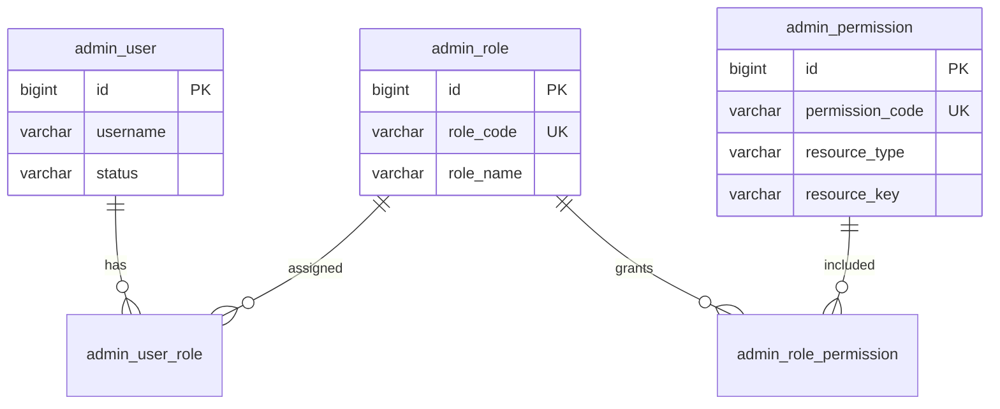

# 阶段 5A：Admin RBAC 权限体系详细设计

> **文档状态**：原则仍有效（JWT 不带权限列表、MENU 与 ACTION 分离、权限码靠种子）。**5B～5D 与 5E 只读已在代码里**，见下表。本文第 12 节不再是「尚未实施的草图」。  
> **最近核对**：2026-10-10（对照 `admin` 的 Controller）  
> **仍未做**：菜单写（`AdminMenuController` 只有 `GET /api/admin/menus`）；后台创建 `permission_code`（`AdminPermissionController` 只有 `GET`，与第 12.2 节「不要在后台造权限码」一致）

| 设计中的接口 | 代码 |
|--------------|------|
| 角色 CRUD 与角色权限 | `AdminRoleController` `/api/admin/roles` |
| 权限只读 | `AdminPermissionController` `GET /api/admin/permissions` |
| 用户角色 | `AdminUserRoleController` `GET/PUT /api/admin/users/{id}/roles` |
| 当前用户 | `AdminAuthMeController` `GET /api/admin/auth/me` |
| 菜单读 | `AdminMenuController` `GET /api/admin/menus` |

**与 5B 的关系**：校验底座的实现约束在 [阶段5B](./阶段5B-Admin-RBAC权限校验底座落地说明.md)。5B 已经落地，该文是当时的自查清单，不是待办。

---

## 1. 阶段背景

### 1.1 认证阶段已完成

| 阶段 | 结论 |
|------|------|
| **4F** | Auth 单服务；登录/刷新/登出/JWT 在 **auth** |
| **4G** | RS256 + JWKS；Admin **`jwk-set-uri`** 验签 |
| **4H** | Gateway **:8080** 全链路联调 |
| **4I** | 路径/Cookie/RequestId/文档收口；认证阶段结束 |

### 1.2 架构边界（固定）

```text
gateway  → 路由、CORS、RequestId、访问日志（不验签、不做 RBAC）
auth     → 登录 / Refresh / Logout / JWT 签发 / JWKS（不做 RBAC）
admin    → Resource Server + 后台业务 + RBAC（角色/权限/授权判断）
common   → 协议、ErrorCode、SubjectCodes、轻量安全契约
infra    → Servlet 日志、i18n、OAuth2 RS 辅助
```

### 1.3 本阶段要解决的问题

| 认证（已完成） | 授权（本阶段设计） |
|----------------|-------------------|
| **你是谁** | **你能做什么** |
| JWT 证明身份 | DB + 方法级权限校验 |
| Auth 签发令牌 | Admin 加载权限并拒绝越权 |

**5A 只做详细设计**，不实现 Controller / Service / Flyway / Method Security。

---

## 2. 阶段目标与范围

### 2.1 目标

- RBAC **业务模型**与实体关系
- **权限码**命名规范与首批清单
- Admin **Resource Server** 与 RBAC **衔接方式**
- **权限校验位置**（URL vs 方法级）及推荐方案
- **权限加载**与后续 **Redis 缓存**方向
- **超级管理员**策略
- **菜单（MENU）** 与 **操作（ACTION）** 边界
- **数据库现状核对**与 **V2 migration** 判断
- **API 草图**与 **5B～5E** 实施拆分

### 2.2 明确不做（5A）

- 业务接口代码、Flyway、改认证链路、改 Auth/Gateway
- Site RBAC、菜单管理 CRUD、角色管理 CRUD
- 在业务方法上直接加 `@PreAuthorize`（留给 **5B**）

---

## 3. 模块职责边界

### 3.1 Auth 不负责 RBAC

Auth **仅**负责：登录、Refresh、Logout、Access JWT 签发、JWKS、认证身份（`subject` + `subject_type` + `aud`）。

Auth **不**负责：角色/权限管理、菜单/按钮授权、业务授权判断、向 JWT 写入权限列表。

### 3.2 Admin 负责 RBAC

Admin 负责：

- `admin_role` / `admin_permission` 及关联表维护（**5C～5D**）
- 当前用户权限解析、方法级校验（**5B**）
- `GET /api/admin/auth/me` 扩展返回 user / roles / permissions / menus（**5B～5E**）
- 后台接口最终权限校验（**不可仅依赖前端隐藏**）

### 3.3 JWT 与权限的关系（硬性原则）

| 项 | 决策 |
|----|------|
| **JWT 是否携带 permissions** | **否**。Access JWT 不塞权限列表、不塞角色列表作为授权依据。 |
| **JWT 携带什么** | **`sub`**（`SubjectCodes` 格式的 userCode，如 `admin:42`）、**`subject_type=ADMIN`**、**`aud`**、**`iss`**、**`iat`/`exp`**、**`jti`**（标准声明）。与现网 **`JwtTokenServiceImpl`** / **`AdminJwtDecoderConfig`** 一致。 |
| **权限从哪来** | Admin 在**每个需授权请求**中，由 `sub` 解析 `userId`，再查 DB（后续可缓存）得到权限码集合。 |
| **缓存** | **5B** 先 DB；**5B+** 可引入 Redis `rbac:admin:user:{userId}:permissions`，角色/权限变更时失效（本阶段仅设计）。 |

说明：历史 claim `admin_user_id` / `username` / `session_id` 已 **deprecated**，展示信息走 **`/api/admin/auth/me`**。

---

## 4. RBAC 业务模型

### 4.1 实体关系

```text
AdminUser
  └── AdminUserRole (M:N)
        └── AdminRole
              └── AdminRolePermission (M:N)
                    └── AdminPermission
```

### 4.2 实体说明

#### AdminUser（`admin_user`）

| 属性 | 说明 |
|------|------|
| 职责 | 后台管理员账号；认证口令校验在 **auth**（读同表），授权在 **admin** |
| 关键字段 | `username`、`status`、`display_name`、软删除 + 审计 |
| 与 RBAC | 通过 **`admin_user_role`** 绑定多个 **`AdminRole`** |

#### AdminRole（`admin_role`）

| 属性 | 说明 |
|------|------|
| 职责 | 角色定义；可分配给多个用户 |
| 关键字段 | **`role_code`**（全平台唯一，如 `super_admin`、`admin`、`editor`、`operator`）、`role_name`、`description`、`status` |
| 示例 | `super_admin` — 超级管理员；`editor` — 内容编辑；`operator` — 运营只读+部分写 |

#### AdminPermission（`admin_permission`）

| 属性 | 说明 |
|------|------|
| 职责 | 权限点；**`permission_code`** 为运行时校验与前端控制的**唯一键** |
| 关键字段 | `permission_code`、`permission_name`、**`resource_type`**、**`resource_key`**、`status` |
| 类型 | 见 §5（MENU / ACTION） |

#### AdminUserRole（`admin_user_role`）

| 属性 | 说明 |
|------|------|
| 职责 | 用户 ↔ 角色；`(admin_user_id, admin_role_id)` 在未删除维度唯一 |

#### AdminRolePermission（`admin_role_permission`）

| 属性 | 说明 |
|------|------|
| 职责 | 角色 ↔ 权限；`(admin_role_id, admin_permission_id)` 在未删除维度唯一 |

### 4.3 ER 示意



---

## 5. 权限类型设计

### 5.1 5A 阶段类型（推荐）

不新增 `permission_type` 列名；**复用现有 `resource_type`**，语义收敛为两类：

| 设计名 | 落库 `resource_type` | 含义 |
|--------|----------------------|------|
| **MENU** | `MENU` | 菜单可见性；驱动前端路由/侧栏 |
| **ACTION** | `ACTION` | 接口 / 按钮 / 操作权限；与方法级 `@RequirePermission` 对齐 |

**不引入**（5A）：`DATA`（行级/字段级数据权限）、独立 `API` 类型（与 ACTION 重复；历史文档中的 `API` 并入 **ACTION**）。

### 5.2 `resource_key` 用法

| resource_type | resource_key 建议 |
|---------------|-------------------|
| **MENU** | 菜单编码或前端路由，如 `system`、`system.user`、路径 `/system/user` |
| **ACTION** | 可与 `permission_code` 相同，或 HTTP 方法+路径模板（运维可读）；**校验以 `permission_code` 为准** |

### 5.3 菜单树与权限行

**5A～5D**：菜单树可由 **`resource_type=MENU`** 的权限行 + **`resource_key` 编码约定** 拼树（如 `parent.child` 前缀或单独 `parent_code` 约定）。

**5E** 若需稳定父子排序，再评估 **V2** 增加 `parent_id`、`sort_order`（见 §11），或独立 **`admin_menu`** 表；**5A 不建表**。

---

## 6. 权限码规范

### 6.1 格式

```text
admin:{domain}:{action}
```

| 段 | 规则 |
|----|------|
| 第一段 | 固定 **`admin`**（后台域） |
| 第二段 | 功能域：`user`、`role`、`permission`、`menu`、`site`、`dashboard` … |
| 第三段 | 动作：`list`、`detail`、`create`、`update`、`delete`、`enable`、`disable`、`assign`、`view` … |
| 字符 | **全小写**，**冒号**分隔；正则建议 `^admin:[a-z][a-z0-9_-]*:[a-z][a-z0-9_-]*$` |

### 6.2 与表字段关系

- **`admin_permission.permission_code`** = 权限码字符串（与上格式一致）
- 运行时 **`hasAuthority('admin:user:list')`** / 自定义 **`@RequirePermission("admin:user:list")`** 使用该字符串

### 6.3 首批建议权限码清单（内置种子，非后台随意创建）

#### 用户与账号

| permission_code | resource_type | 说明 |
|-----------------|---------------|------|
| `admin:user:list` | ACTION | 用户列表 |
| `admin:user:detail` | ACTION | 用户详情 |
| `admin:user:create` | ACTION | 创建用户 |
| `admin:user:update` | ACTION | 更新用户 |
| `admin:user:delete` | ACTION | 删除/软删用户 |
| `admin:user:enable` | ACTION | 启用 |
| `admin:user:disable` | ACTION | 禁用 |
| `admin:user:assign-role` | ACTION | 分配角色（**5D**） |

#### 角色与权限

| permission_code | resource_type | 说明 |
|-----------------|---------------|------|
| `admin:role:list` | ACTION | 角色列表 |
| `admin:role:detail` | ACTION | 角色详情 |
| `admin:role:create` | ACTION | 创建角色 |
| `admin:role:update` | ACTION | 更新角色 |
| `admin:role:delete` | ACTION | 删除角色 |
| `admin:role:assign-permission` | ACTION | 绑定权限（**5C**） |
| `admin:permission:list` | ACTION | 权限点只读列表 |

#### 菜单（可见性）

| permission_code | resource_type | resource_key 示例 |
|-----------------|---------------|-------------------|
| `admin:menu:system` | MENU | `system` |
| `admin:menu:system.user` | MENU | `system.user` |
| `admin:menu:system.role` | MENU | `system.role` |
| `admin:menu:dashboard` | MENU | `dashboard` |

#### 站点与仪表盘（预留）

| permission_code | resource_type | 说明 |
|-----------------|---------------|------|
| `admin:site:list` | ACTION | 站点列表（未来） |
| `admin:site:update` | ACTION | 站点配置 |
| `admin:dashboard:view` | ACTION | 仪表盘访问 |

#### 当前用户上下文

| permission_code | resource_type | 说明 |
|-----------------|---------------|------|
| `admin:auth:me` | ACTION | 访问 `GET /api/admin/auth/me`（可与「已登录」合并，见 §7） |

> **种子数据**：建议在 **5B 或 5C** 通过 **Flyway V2 数据脚本** 或 **应用启动 Import** 写入；**5A 不执行 migration**。

---

## 7. 权限校验方式

### 7.1 方案比较

| 维度 | 方案 A：URL `authorizeHttpRequests` | 方案 B：方法级 Method Security |
|------|--------------------------------------|--------------------------------|
| 配置位置 | `AdminSecurityConfig` 按路径匹配 | Controller/Service 注解 |
| 优点 | 集中、适合粗粒度 | 与业务动作一一对应、可维护 |
| 缺点 | 路径膨胀、难表达「同 URL 不同动作」 | 需权限加载与 SpEL/自定义 Evaluator |
| 适合 | 「是否登录」 | **具体 permission_code** |

### 7.2 推荐结论（5B 实施依据）

```text
URL 层：只负责 authenticated（+ Swagger/Actuator 放行）
方法层：具体 permission 使用 Method Security
```

| 层级 | 行为 |
|------|------|
| **`AdminSecurityConfig`** | 保持 **`anyRequest().authenticated()`**（现状）；**不**按 URL 绑 `admin:user:list` |
| **方法级** | `@EnableMethodSecurity` + **`@PreAuthorize`** 或自定义 **`@RequirePermission("admin:user:list")`** + **`PermissionEvaluator` / `PermissionChecker`** |
| **拒绝响应** | 复用 **`AdminAccessDeniedHandler`** + i18n（如 `auth.forbidden` / 新增 `admin.permission.denied`） |

**`/api/admin/auth/me`**：仅需 **已登录**即可（URL 已 authenticated）；返回的 permissions 用于前端，**不能**替代后端校验。

### 7.3 与 Resource Server 的衔接

```text
Bearer JWT → JwtDecoder (JWKS) → JwtAuthenticationToken
  → AuthContextSynchronizingFilter → AuthContext (userCode / subject)
  → (5B) AdminPermissionService 加载权限 → GrantedAuthority 或 ThreadLocal PermissionSet
  → @RequirePermission 校验
```

- **身份**来自 JWT（**auth** 签发）。
- **授权**来自 **admin** DB（**auth** 不参与）。

---

## 8. 权限加载与缓存

### 8.1 初期（5B）

每次请求（或每个 `@RequirePermission` 切入点）：

1. 从 **`AuthContext`** / `JwtAuthenticationToken` 取 **`sub`** → **`SubjectCodes.parseAdminUserId`**
2. SQL 查询有效权限（示意）：

```sql
SELECT DISTINCT p.permission_code
FROM admin_user_role ur
JOIN admin_role r ON r.id = ur.admin_role_id AND r.deleted = FALSE AND r.status = 'ACTIVE'
JOIN admin_role_permission rp ON rp.admin_role_id = r.id AND rp.deleted = FALSE
JOIN admin_permission p ON p.id = rp.admin_permission_id AND p.deleted = FALSE AND p.status = 'ACTIVE'
WHERE ur.admin_user_id = :userId AND ur.deleted = FALSE;
```

3. 若用户拥有 **`super_admin`** 角色 → **短路**（见 §9），可跳过 SQL 或仍查库后合并「全量」

**性能**：管理员规模小可接受；高 QPS 后再缓存。

### 8.2 后续缓存（设计，5B+ / 5C 变更时落地）

| 项 | 建议 |
|----|------|
| Key | `rbac:admin:user:{userId}:permissions`（Set 或 JSON 数组） |
| TTL | 可设 5～30 分钟 + 主动失效 |
| 失效 | 用户角色变更、角色权限变更、权限 `status` 变更、用户 disable → **DEL** 该用户 key；或 **全局 rbac:version** 递增 |
| 一致性 | **写路径先 DB 后删缓存**；读路径 cache-aside |

### 8.3 `/api/admin/auth/me` 加载

与校验**同源**（同一 `AdminPermissionQueryService`）：

- **userInfo**：`admin_user` 行
- **roles**：`role_code` 列表
- **permissions**：`permission_code` 列表（**ACTION** 为主；是否包含 MENU 由产品定，建议 **全部返回** 供前端 `v-if`）
- **menus**：由 **MENU** 类型权限 + `resource_key` 构建树（**5E** 完善）

**现状（2026-10-10）**：`AdminAuthMeController` 调用 `AdminAuthMeService.loadCurrentAdminContext()`，从库组装用户、角色、权限和菜单。早先的硬编码 `SUPER_ADMIN` 占位已经替换。菜单写接口仍然没有。

---

## 9. 超级管理员策略

### 9.1 推荐：特殊角色（非用户字段）

| 项 | 决策 |
|----|------|
| 表达 | **`admin_role.role_code = 'super_admin'`** |
| 不推荐 | 新增 `admin_user.is_super_admin`（除非后续强需求） |

### 9.2 权限判断短路（5B 实现二选一）

| 策略 | 说明 | 推荐 |
|------|------|------|
| **A. 逻辑短路** | 检测到 `super_admin` 角色 → **`PermissionChecker` 直接通过** 任意 `@RequirePermission` | **推荐**（无需维护全量绑定） |
| **B. DB 全绑** | `super_admin` 在 `admin_role_permission` 绑定所有权限行 | 数据量大、维护成本高 |

**5A 决策**：采用 **策略 A**；种子数据仅需 **角色 + 用户绑定**，不必为 `super_admin` 插入全部 `admin_role_permission`。

### 9.3 与首账号 bootstrap 的关系

认证阶段 **`POST /api/auth/admin/register`** bootstrap 创建的用户，**5D** 应默认绑定 **`super_admin`**（或文档化运维步骤）。

---

## 10. 菜单权限设计

### 10.1 分离原则

| 类型 | 控制什么 | 后端校验 |
|------|----------|----------|
| **MENU** | 侧栏/路由**是否可见** | 接口仍须 **ACTION**；仅隐藏菜单**不能**阻止直接调 API |
| **ACTION** | 按钮与 REST **是否可执行** | **Method Security 必须校验** |

### 10.2 前端协作（5A 仅设计）

- **`GET /api/admin/auth/me`** 返回 **menus** 树 + **permissions** 扁平列表
- 前端：`menus` 控制路由；`permissions.includes('admin:user:create')` 控制按钮
- **后端**：每个写接口仍声明 `@RequirePermission`

### 10.3 菜单管理

**菜单 CRUD、动态路由配置** 不在 **5A～5D**；归 **5E**。5E 前菜单数据来自 **内置 permission 种子** + `resource_key` 约定。

---

## 11. 数据库现状核对

### 11.1 表存在性与 RBAC 满足度

| 表 | Flyway V1 | Entity/Mapper | 满足基础 RBAC | 说明 |
|----|-----------|---------------|---------------|------|
| `admin_user` | ✅ | ✅ | ✅ | 账号主体 |
| `admin_role` | ✅ | ✅ | ✅ | 含 `role_code`、`role_name`、`status` |
| `admin_permission` | ✅ | ✅ | ✅ | 含 `permission_code`、`resource_type`、`resource_key` |
| `admin_user_role` | ✅ | ✅ | ✅ | M:N + partial unique |
| `admin_role_permission` | ✅ | ✅ | ✅ | M:N + partial unique |

**结论**：**V1 五表已满足 5B～5D 的核心 RBAC**，无需为「能绑角色、能校权限码」而立刻做 V2。

### 11.2 与 5A 目标字段对照

| 建议字段 | 现状 | 5A 判断 |
|----------|------|---------|
| `admin_role.role_code` | ✅ | 满足 |
| `admin_role.role_name` | ✅ | 满足 |
| `admin_role.status` | ✅ | 满足 |
| `admin_role.sort_order` | ❌ | **可选 V2**（角色列表 UI 排序，非阻塞） |
| `admin_permission.permission_code` | ✅ | 满足 |
| `admin_permission.permission_name` | ✅ | 满足 |
| `permission_type` | 无；有 **`resource_type`** | **复用 `resource_type`**，不新增列 |
| `parent_id` / 菜单层级 | ❌ | **5E 再评估 V2** 或独立 `admin_menu` |
| `route_path` | 无；可用 **`resource_key`** | 5B～5D 够用 |
| `sort_order`（权限） | ❌ | **5E 可选 V2** |

### 11.3 是否需要 V2 migration

| 场景 | 是否需要 V2 | 阶段 |
|------|-------------|------|
| 用户-角色-权限绑定 + 方法级校验 | **否** | 5B～5D |
| 内置权限/角色种子数据 | **是（数据脚本）** | 5B 或 5C |
| 菜单父子排序、`parent_id` | **可选结构 V2** | 5E |
| `resource_type` 历史值 `API` 清洗为 `ACTION` | **可选数据 V2** | 5C 种子时统一 |

**5A 结论**：**不强制 V2 结构 migration**；**5B 起可能需要 V2__*_seed_rbac.sql**（仅 INSERT 种子，非改表）。

### 11.4 数据字典与代码

- 权威字典：[Admin认证授权数据字典](../../数据字典/Admin认证授权数据字典.md)
- DDL：`infra/.../V1__init_platform_core_tables.sql`
- 实体：`AdminRoleEntity`、`AdminPermissionEntity`、`AdminUserRoleEntity`、`AdminRolePermissionEntity`

---

## 12. API 草图（已按上表落地，菜单写除外）

> 路径前缀均为 **`/api/admin/**`**，需 **Bearer**；具体 permission 见 **5B** 方法级注解。

### 12.1 角色管理（5C）

| 方法 | 路径 | 建议权限 |
|------|------|----------|
| GET | `/api/admin/roles` | `admin:role:list` |
| GET | `/api/admin/roles/{id}` | `admin:role:detail` |
| POST | `/api/admin/roles` | `admin:role:create` |
| PUT | `/api/admin/roles/{id}` | `admin:role:update` |
| DELETE | `/api/admin/roles/{id}` | `admin:role:delete` |

### 12.2 权限管理（5C）

| 方法 | 路径 | 建议权限 |
|------|------|----------|
| GET | `/api/admin/permissions` | `admin:permission:list` |

**是否允许后台创建 `permission_code`**：

| 决策 | 说明 |
|------|------|
| **推荐** | **否**（或仅 **super_admin** 运维工具）；权限码由**版本化种子 / 代码枚举**维护 |
| 后台能力 | **只读列表** + **角色绑定**；新增权限随发版 Flyway/种子导入 |

### 12.3 角色权限绑定（5C）

| 方法 | 路径 | 建议权限 |
|------|------|----------|
| GET | `/api/admin/roles/{id}/permissions` | `admin:role:detail` |
| PUT | `/api/admin/roles/{id}/permissions` | `admin:role:assign-permission` |

请求体：`{ "permissionIds": [1,2,3] }` 或 `permissionCodes`（5C 定稿）。

### 12.4 用户角色绑定（5D）

| 方法 | 路径 | 建议权限 |
|------|------|----------|
| GET | `/api/admin/users/{id}/roles` | `admin:user:detail` |
| PUT | `/api/admin/users/{id}/roles` | `admin:user:assign-role` |

### 12.5 当前用户上下文（5B 增强）

| 方法 | 路径 | 说明 |
|------|------|------|
| GET | `/api/admin/auth/me` | 返回 `user`、`roles`、`permissions`、`menus`（替换占位） |

**响应草图**：

```json
{
  "code": 0,
  "message": "success",
  "data": {
    "user": { "userCode": "admin:1", "username": "...", "displayName": "...", "status": "ACTIVE" },
    "roles": ["super_admin"],
    "permissions": ["admin:user:list", "admin:menu:system"],
    "menus": [{ "menuCode": "system", "menuName": "系统管理", "path": "/system", "children": [] }]
  }
}
```

---

## 13. 与前端的关系

- 后端通过 **`/api/admin/auth/me`** 提供 **permissions** + **menus**
- 前端控制菜单与按钮展示；**所有写操作**仍须后端 **ACTION** 校验
- **安全原则**：前端隐藏 ≠ 授权；直接调 API 必须 **403**

---

## 14. 后续实施阶段拆分

| 阶段 | 范围 | 交付 |
|------|------|------|
| **5B RBAC 权限校验底座** | `AdminPermissionQueryService`、`PermissionChecker`、`@EnableMethodSecurity` + `@RequirePermission`、真实 **`/api/admin/auth/me`**、可选 Redis 设计留接口 | 能按 permission_code 拒绝请求 |
| **5C 角色与权限管理** | 角色 CRUD、权限只读列表、角色-权限 PUT、RBAC **种子数据** | 运维可配角色权限 |
| **5D 管理员与角色绑定** | 用户列表/详情（若尚无）、用户-角色 PUT、`super_admin` 绑定策略 | 用户具备角色 |
| **5E 菜单权限与后台导航** | MENU 树构建、排序/父子（或 V2）、与前端路由契约 | 完整侧栏体验 |

**依赖顺序**：**5B → 5C → 5D → 5E**（5C/5D 可部分并行，但 **5B 必须先于** 带权限注解的业务接口）。

**5B 承接说明**：后续 **5B** 的实现与审查以 **[《阶段5B-Admin-RBAC权限校验底座落地说明》](./阶段5B-Admin-RBAC权限校验底座落地说明.md)** **§7 自查清单**为准（与本文 §7 权限校验方案、§8 加载设计一致；落地细节、禁止项与 `rg` 命令以 5B 文档为准）。

---

## 15. 风险与待确认项

| # | 项 | 建议默认 | 确认时机 |
|---|-----|----------|----------|
| 1 | `super_admin` 短路 vs 全量绑定 | **短路** | 5B 开发前 |
| 2 | `/auth/me` 是否返回 MENU 类型 permission 字符串 | **返回**（与 ACTION 合并列表） | 5B |
| 3 | 权限种子：Flyway vs 启动 Runner | **Flyway V2 数据脚本** | 5B/5C |
| 4 | 5E 是否新增 `admin_menu` 表 | **优先复用 `admin_permission`**，不够再 V2 | 5E 设计评审 |
| 5 | 403 message key | `admin.permission.denied` 或复用 common | 5B |
| 6 | bootstrap 用户是否自动 `super_admin` | **是** | 5D |
| 7 | `editor`/`operator` 等内置角色是否预置 | **5C 种子可选** | 5C |

---

## 16. 5A 关闭标准

- [x] 本文档评审通过，与 V1 表结构、现网 JWT/Security 一致
- [x] 路线图 / 完成度 / README 已标记 **5A 完成**
- [ ] 团队确认 §15 待确认项（可边做 5B 边定）

**5A 完成后允许进入：5B RBAC 权限校验底座落地。**

---

## 17. 修订记录

| 日期 | 说明 |
|------|------|
| 2026-05-20 | 初版：5A 详细设计交付 |
| 2026-05-20 | §14 增加 5B 文档 §7 自查清单交叉引用 |
| 2026-05-21 | 文首与 5B 落地说明交叉引用（§7 / §17 自查） |
