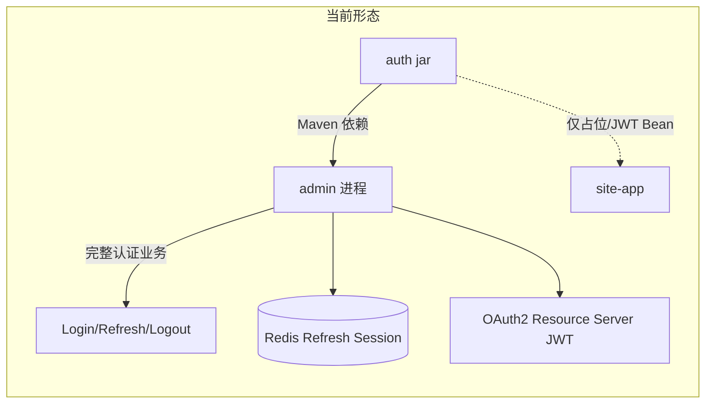
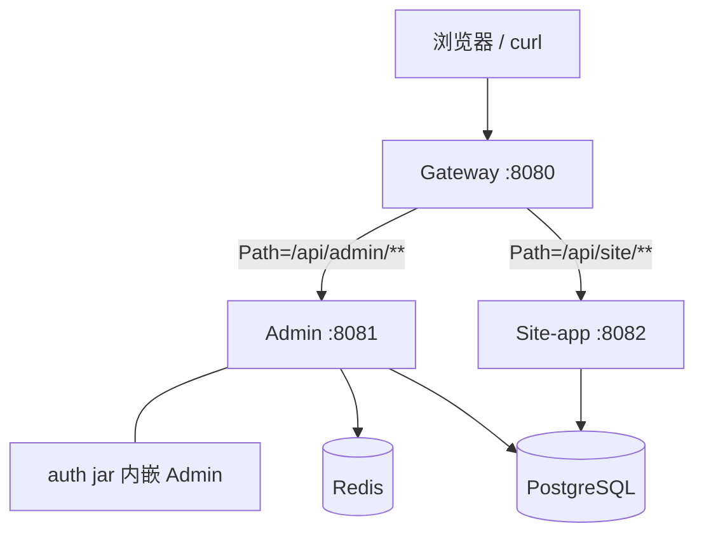
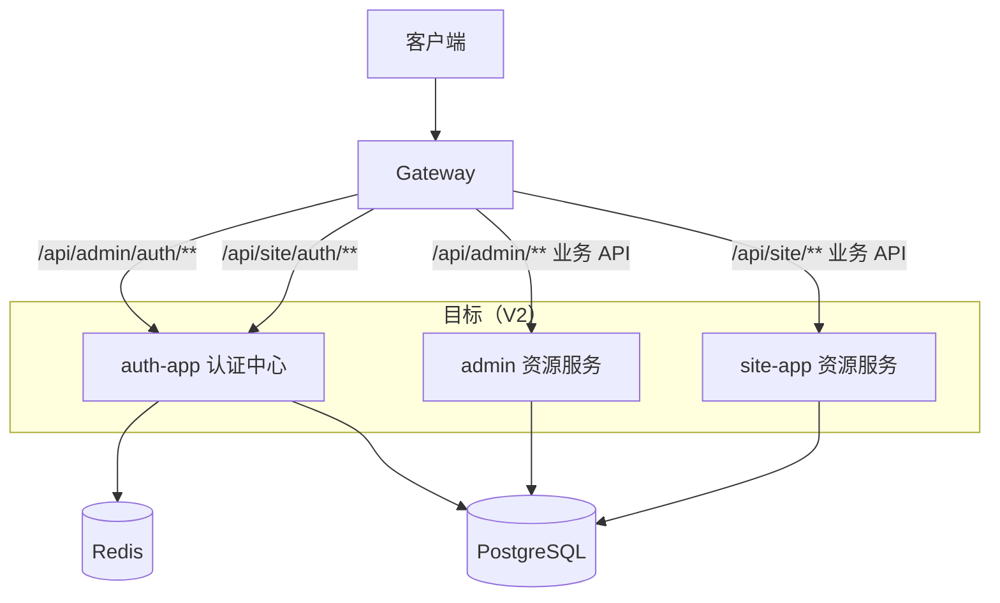

# 阶段 4D：Auth 独立认证服务架构回归设计、现状审计与迁移方案

> **文档状态**：当前有效（**架构决策与迁移主线**；**运行时事实**须与 **[阶段4F](./阶段4F-Auth单服务收敛与认证主链路上提落地说明.md)**、**[架构设计](../基础架构/架构设计.md)** 交叉核对）  
> **对应阶段**：4D（设计定案）→ 4E（过渡实现）→ **4F（已收敛）**  
> **当前适用性**：**4D 审计表中的「当前模块」列**描述的是 **4D 成文当时**的旧事实；**现状**以 **4F** 为准。  
> **最近同步**：2026-05-17  

---

## 〇、4F 实施结果（当前架构事实，必读）

以下内容 supersede 本文 **§二「现状审计」** 中与进程边界相冲突的表述：

1. **`auth` 为单一、可执行的 Spring Boot 模块**（**不再有 `auth-core` / `auth-app` Maven 拆分**）。  
2. **认证主链路 HTTP**（Admin **Login / Refresh / Logout**）由 **`auth`（默认 8083）** 承载；**`admin`** 为 **OAuth2 Resource Server** + 业务 API。  
3. **`gateway`** 路由：**`/api/admin/auth/**`**、**`/api/site/auth/**`** → **`auth`**；**`/api/admin/**`**（非 auth 前缀的业务路径）→ **`admin`**。  
4. **RS256 + JWKS**：**4G 已完成**；**auth** 持私钥签发并发布 **`/.well-known/jwks.json`**；**admin** 仅 **`jwk-set-uri` 验签**，**不再**使用 `SECURITY_JWT_SECRET` 作为主链路配置。详见 [**阶段4G**](./阶段4G-RS256与JWKS签名验签体系迁移说明.md)。  
5. **下一阶段执行顺序**：**4H**（Gateway 全链路真实联调与脚本）→（按需）**4I** 清理 → **5A** RBAC。  

详细落地清单见 **[阶段4F-Auth单服务收敛与认证主链路上提落地说明.md](./阶段4F-Auth单服务收敛与认证主链路上提落地说明.md)**。

---

> **历史保留（4E 成文时）**：下段描述 **4E 阶段**曾存在的 **`auth-core` + `auth-app`** 形态；**已被 4F 单模块 `auth` 取代**，仅供追溯，**不得**当作当前 Maven 结构。  
> **阶段 4E（过渡，已被 4F 替代）**：曾规划 `auth/` 为 Maven 聚合父模块，子模块 **`auth-core`** 与 **`auth-app`**；**4F** 已将其**收敛**为单一 **`auth`** 可执行模块，并完成 **Login/Refresh/Logout** 上提与 **Gateway** 路由拆分。

> **文档性质（原始摘要）**：设计与审计定案（4D）；原「迁移实施见 4E 起」已推进至 **4F 完成**。  
> **Roadmap**：**暂停 5A（RBAC 深化）** 直至 **4H** 就绪。  
> **关联**：[`架构设计`](../基础架构/架构设计.md) §6、[`.env.example` 范本](../../../services/website-services/.env.example)。

---

## 一、阶段背景

### 1.1 已完成工作（简述）

| 条目 | 状态 |
|------|------|
| Admin 认证基础代码（登录 / Refresh / Logout） | ✅ 已实现 |
| 后端系统消息国际化底座（infra + common + 模块 bundles） | ✅ 已实现 |
| Admin 认证真实联调与安全边界验证（阶段 4C） | ✅ 文档与脚本可查 |
| site-app PostgreSQL Runtime 等与库连接相关修正 | ✅ 已实现 |

### 1.2 与最初目标的偏移（必须纠正的认知）

**最初目标**：`auth` 应是 **可与 Admin / Site 并列部署的认证中心**，统一承载登录、Token 签发、Refresh Rotation / Replay、Logout、会话与认证错误语义等 **认证主流程**；Admin / Site 侧重 **认证域与用户表差异**，而非重复整套认证流水线。

**当前实际**：



- **`auth`**：可复用的 **技术模块**（`TokenService`、`JwtProperties`、`AuthContext`、`RefreshTokenGenerator` 等）；**无可独立启动的 AuthApplication**。  
- **`admin`**：**自己实现** Login/Refresh/Logout 编排、HttpOnly Cookie、Redis 会话存储、轮换与重放防御、Security 装配与用户查询。  
- **风险**：Site 登录若照搬当前模式，会 **重复一整套认证主干**，违背「单一认证中心」原则。

---

## 二、第五部分完成情况：现状审计（第一部分交付）

### 2.1 审计范围模块

`services/website-services/` 下的 `auth`、`admin`、`site/site-app`、`gateway`、`infra`、`common` 及根 `pom.xml`（聚合与模块声明）。

### 2.2 当前认证能力归属表

| 能力 | 当前模块 | 当前类 / 配置 | 是否符合最初 auth-service 目标 | 未来建议归属 |
|------|-----------|----------------|----------------------------------|--------------|
| Access JWT 签发 | admin（编排）；auth（实现） | `AdminAuthServiceImpl` → `auth.token.TokenService` / `JwtTokenService` | **否**（签发逻辑在 Admin 编排内） | **auth-app**：签发中心化；过渡期可沿用 `JwtTokenService` 上提 |
| JWT 验签配置 | admin | `AdminSecurityConfig` → `oauth2ResourceServer().jwt()` | **否**（验签在同一业务服务进程） | **admin**：仅 Resource Server；验签取自 **JWKS**（auth 发证）长期目标 |
| `JwtEncoder` / `JwtDecoder` beans | auth（条件装配） | `AuthConfig.JwtBeans` + `JwtBeansEnabledCondition` | **部分**（库内 Bean，运行在 admin） | **auth-app**：私钥签发；admin/site：**公钥 / jwk-set-uri** |
| Token Claims | auth | `TokenClaims`、`JwtClaimConstants`、`JwtClaimNames` | ✅ 与技术一致 | **auth-core**：模型与常量；**auth-app**：组装策略 |
| `TokenAudience` | auth | `TokenAudience.java`（ADMIN / SITE 枚举语义） | ✅ | **auth-core** |
| Refresh Token 生成 | auth | `RefreshTokenGenerator` | ✅ 仅占生成 | **auth-app**：与安全策略同属认证中心 |
| Refresh Session 存储 | admin | `AdminRefreshSessionService`、`RedisAdminRefreshSessionServiceImpl` | **否** | **auth-app**：Redis Key 租户化（见第九章） |
| Rotation | admin | `AdminAuthServiceImpl` + `RedisAdminRefreshSessionServiceImpl` | **否** | **auth-app** |
| Replay 防御 | admin | Redis `refreshReplay` 索引（见 `RedisAdminRefreshSessionServiceImpl`） | **否** | **auth-app** |
| Login 编排 | admin | `AdminAuthController` + `AdminAuthServiceImpl` | **否** | **auth-app**（HTTP 契约可经 Gateway 保持路径兼容） |
| Logout 编排 | admin | 同上 | **否** | **auth-app** |
| Cookie 生成与清除 | admin | `AdminRefreshCookieService`、`AdminRefreshCookieServiceImpl` | **否** | **auth-app** 或网关/BFF协同（第十章） |
| Admin 用户查询 | admin | `AdminUserMapper` + `AdminUserEntity` | ✅ 应在业务边界 | **推荐**：Auth 独立后通过 **infra 可读库 + 共享 schema** 的内部模块或 **`auth-user-persistence`** 子模块查 `admin_user`（见第七章），避免 admin 反向暴露 DAO |
| 用户状态校验 / BCrypt | admin | `AdminAuthConstants`、`PasswordEncoder` | **编排层**应在 auth-app；**校验规则**可复制或接口化 | **auth-app**：编排层；常量可 **auth-core** 或配置文件 |
| `SecurityFilterChain`（Resource Server） | admin | `AdminSecurityConfig` | ✅ 边界正确类型 | **admin**：仅此类型；移除登录端点放行后的「认证流水线」迁至 auth-app |
| `AuthContext` / Principal | auth + admin filter | `auth.context`、`AuthenticatedUserUtils`；`AuthContextSynchronizingFilter` | **部分**（Resource Server 侧合理） | **admin/site**：过滤器保留；principal 建模可 **auth-core** 共享 |
| 国际化认证错误 | admin（业务键）+ infra + auth（通用键占位） | `admin`：`i18n/admin/*`（`admin.auth.*`）；`auth`：`i18n/auth/*`（条目很少） | **部分**（登录口令等键在 admin） | **auth-app**：聚合「认证语义」文案；resource server：`invalid_token`/scope 等与 Spring 对齐的补充键可留 **admin/site** |
| Swagger Auth API | admin | `@Tag`/`Admin Auth` OpenAPI | **当前正确模块**（临时） | **auth-app**：主 OpenAPI |
| 4C 联调脚本 / seed | 仓库脚本 | `scripts/local/*`、`README-4C-seed`、`seed-admin-local-verify.sql` | **过程资产** | 随 ** auth-app** URL 演进更新；用户名随 `.env` 不再固定个人账号 |

### 2.3 当前形态简图（与网关）



**说明**：`gateway/application.yml` 当前 **仅有** `/api/admin/**` → admin、`/api/site/**` → site；**无独立 auth-service 路由**。

### 2.4 `site-app` / `gateway` / `infra` / `common` 认证相关简述

| 模块 | 与认证相关的当前状态 |
|------|---------------------|
| **site-app** | 依赖 `auth` jar；暂无 Site 登录与 Resource Server 业务链路；`GET /api/site/ping`。 |
| **gateway** | 纯路由 + CORS；**不做 JWT 校验**（本阶段不修改）。 |
| **infra** | Flyway DDL 含 **`admin_user` / `site_user`** 等；国际化底座；可被多服务复用数据源配置。 |
| **common** | `ErrorCode`、`BusinessException`、`ApiResponse`；与认证错误码并存。 |

---

## 三、目标架构 —— auth 独立认证服务（第二部分交付）

### 3.1 目标总体拓扑



- **`auth-service`（auth-app）**：可独立进程启动；**仅有** Login / Refresh / Logout（及 JWKS）；持有 **签发私钥 / 会话**。  
- **admin / site**：**Resource Server**；验 **Access JWT**（长期 **RS256 + `jwk-set-uri`**）；**不做** Refresh 会话主链路。  

### 3.2 推荐 Maven 结构（与本仓库衔接）

```text
website-services/
├── auth/
│   ├── pom.xml                     # 可选：packaging=pom，聚合 auth-core / auth-app
│   ├── auth-core/                  # JWT/Claims/上下文/共用 SPI（由现有 auth 源码主体迁入）
│   └── auth-app/                   # 可启动：AuthApplication，依赖 auth-core + infra（按需）
├── admin/
├── site/
├── gateway/
├── infra/
├── common/
└── pom.xml
```

**理由**：

- **拆分 `auth-core` / `auth-app`**：与当前「库 vs 进程」错位对齐；共用模型不必重复打包进 admin/site。  
- **与现有单模块 `auth` 的关系**：现有 `auth` 代码 **主体归入 `auth-core`**；Boot 入口、控制器、会话、安全配置 **新增到 `auth-app`**（本轮不编码）。  
- **避免凭空 `auth-service/` 顶层目录**：在 **`auth/`  Maven 聚合下挂载子模块**，复用坐标与语义。

---

## 四、Admin / Site 接入 Auth（第三部分交付）

### 4.1 认证域（Realm / Audience）

| 维度 | 建议 |
|------|------|
| **Audience** | 沿用 `TokenAudience`：`ADMIN`、`SITE`。Access JWT **`aud`** 区分域。 |
| **登录路径** | 推荐 **路径分域**：`/api/admin/auth/login`、`/api/site/auth/login`，与 Gateway 前缀一致；**避免**单一模糊接口增加网关路由与安全策略复杂度。 |
| **Refresh Cookie** | **分域**：不同 Cookie 名称与 `Path`（例如 `admin_refresh_token` vs `site_refresh_token`，Path 与各站前端挂载一致）；**HttpOnly`、`SameSite`、** **`Secure`** 按 profile 配置。 |

### 4.2 Auth 读取不同用户的方案对比与本项目推荐

| 方案 | 描述 | Provider 归属 | admin/site 耦合 | 环依赖风险 |
|------|------|----------------|-----------------|------------|
| **A：Auth 直连表** | `auth-app` + `infra`，同一库 JDBC 直连 `admin_user` / `site_user`（MyBatis Mapper 建在 **auth-app 独占包**或通过 **small `auth-infra`** 模块） | Mapper 仅在 auth 树下 | Admin 不向外暴露 Mapper | **低**（单库共用 schema） |
| **B：Provider SPI** | `auth-core` 定义 `AuthenticatedUserLookup` SPI；运行时仅 **auth-app** 装载 `AdminUserLookup` / `SiteUserLookup` 实现（实现类同属 auth-app，`@ConditionalOn*`） | 实现仅在 auth-app | 无反向依赖 admin jar | **低** |

**本项目推荐**：**方案 A（Auth 在同一 PostgreSQL schema 直连认证相关表）+ 轻度 SPI / 分包隔离**。

- **依据**：Flyway **`V1`** 已创建 **`admin_user`、`site_user`**；当前为 **共享库、共享 schema**。  
- **允许**：`auth-app` **直接查询**认证域表（或只读视图），**不须**经由 admin/site HTTP——避免循环依赖与不必要网络跳数。  
- **避免 DAO 外传**：不重用在 `admin` 包内的 `Mapper` 类型；若在 **Maven** 层面复用 infra 生成的基类可以接受，业务 **Entity/Mapper** 可归 **`auth/auth-app` 独占包**或通过 **`auth-integration-db`** 子模块只对表 `admin_user`、`site_user` 建薄 Mapper（由 4F 决断）。  

**未来演进（非本阶段）**：若拆库，`auth-app` 可改为 **RPC / 内部 API**（BFF 调用 admin/site 只返回脱敏用户信息），需在 **数据库模型设计** 中单独立项。

---

## 五、JWT 签发与验签（第四部分交付）

### 5.1 当前状态（4B / 4C）

- **HS256**；`JwtEncoder`/`JwtDecoder` 与 **对称密钥 `SECURITY_JWT_SECRET`** 同在 **admin 进程**（由 `auth.jar` Bean 装配）。  
- Admin 同时 **签发又验签**。

### 5.2 独立 Auth 后继续 HS256 的问题

对称密钥若在 **admin、site** 各持一份：**密钥面扩散**，与「仅认证中心可证明身份」相悖；轮换时需多服务滚动。

### 5.3 **本阶段结论（V2 推荐）**

| 项目 | 结论 |
|------|------|
| **V2 是否推荐 HS256→RS256** | **推荐**。Auth 保管 **私钥**；admin/site/Gateway（若需要）仅 **拉 JWKS / 嵌入公钥** 验签。 |
| **`auth-service` 是否暴露 JWKS** | **建议提供** `/.well-known/jwks.json`（或 Spring Authorization Server / Nimbus **JWK Set**端点等价物）；支持 **密钥轮换（kid）**。 |
| **admin/site Resource Server** | `spring.security.oauth2.resourceserver.jwt.jwk-set-uri=http://auth:.../jwt/jwks`（具体路径 4G 定稿）。 |
| **4B HS256 代码复用** | **保留**：Claims 建模、`JwtBeansEnabledCondition` 思路、签发管线抽象；**替换**：对称 `SecretKey` → `RSAKey`/JWKSource；解码端改为 **`NimbusJwtDecoder` + JWKS**。 |

---

## 六、Refresh Session 上提（第五部分）

| 议题 | 设计建议 |
|------|----------|
| **Redis Key** | **`auth:{realm}:session:{sid}`**，`realm ∈ {admin,site}` 或租户化 **`auth:d:{realm}:...`**；Replay/Rotation 同理 **`auth:{realm}:refresh:index:{hash}`**。 |
| **Cookie 谁来 Set** | **优先 auth-app 直连响应 `Set-Cookie`**（语义清晰）；若必须经 **Gateway**，需 **`proxy_cookie_path`/`AddResponseHeader`** 等能力评估，**复杂度更高**。 |
| **Admin/Site 是否持有 Refresh Plain** | **否**；不透明 Refresh 仅 Cookie + Auth 服务端存储映射。 |
| **Logout** | **统一 `/api/*/auth/logout`** 由 Auth 作废会话 **并**下发清 Cookie（与 Rotation 同属 Auth）。 |

---

## 七、Security 装配分工（第六部分）

| 组件 | auth-app | admin | site-app | gateway（设计） |
|------|----------|-------|----------|----------------|
| Login/Refresh/Logout | ✅ | ❌（最终） | ❌（最终） | 仅路由转发 |
| 签发 JWT + 会话 | ✅ | ❌ | ❌ | （可选日后验签，本阶段不测） |
| OAuth2 RS JWT 校验 | ❌ | ✅ | ✅（Site 登录后） | 暂不强制 |
| 业务 API RBAC（5A） | ❌ | ✅ 后续 | ✅ 后续 | — |

---

## 八、环境变量与敏感配置（第七部分）

### 8.1 本轮已落地的 `.env.example` 收敛

- **不得**再以个人本地账号 / 看起来像真实口令的字符串作为范本；范本使用 **`mywebsite`** + **`CHANGE_ME`** 等与个人环境无关的占位。  
- **JWT**：HS256 阶段仍须有 **≥32 字节 UTF-8** 的占位说明——范本中使用 **明确占位长串**，并在注释中标明需在个人 `.env` 中替换为随机值。

### 8.2 目标服务级分域（不要求本轮改全量 YAML）

示例（迁移期可与「共享 `DB_*`」并存，按阶段切换）：

| 域 | 变量示例 |
|----|----------|
| **基础设施 Compose** | `POSTGRES_*`、`REDIS_*` |
| **auth-app** | `AUTH_DB_*` 或共用 `DATABASE_URL`、`AUTH_JWT_PRIVATE_KEY`、`AUTH_ISSUER_URI`、`AUTH_REDIS_*` |
| **admin** | `ADMIN_DB_*`（或与 auth 分摊只读）；**`ADMIN_JWK_SET_URI`** |
| **site** | `SITE_DB_*`；**`SITE_JWK_SET_URI`** |

渐进策略：**4F 前**：仍可用统一 `DB_URL`（单库）；**4G 后**：强推 **`jwk-set-uri`** 与各服务数据源显式前缀，避免耦合。

---

## 九、4B / 4C 代码迁移归属表（第八部分）

| 当前类 / 资源 | 当前模块 | 目标归属 | 动作 | 理由 |
|----------------|----------|----------|------|------|
| `TokenService`、`JwtTokenService` | auth | auth-core | **保留+演进** | 抽象签发；4G 换实现 |
| `JwtProperties` | auth | auth-core → auth-app binding | **上提绑定** | 私钥/Issuer 等属于认证中心配置 |
| `AuthConfig`、`JwtBeansEnabledCondition` | auth | auth-core / auth-app | **拆分** | 条件 Bean 语义保留；Issuer 迁至 app |
| `TokenAudience`、`IssuedAccessToken`、`TokenClaims`、常量类 | auth | auth-core | **保留** | 域模型共享 |
| `RefreshTokenGenerator` | auth | auth-core | **保留** | 无状态生成 |
| `AuthContext`、`AuthenticatedUser*` | auth | auth-core | **保留** | 资源服务仍用 |
| `i18n/auth/*` | auth | auth-app | **合并扩展** | 认证错误主文案上移 |
| `AdminAuthController` | admin | auth-app（HTTP） | **上提（4F）** | 认证入口 |
| `AdminAuthService(Impl)` | admin | auth-app | **拆分/上提** | 编排归入 Auth；用户查询可查表或端口 |
| `AdminRefreshCookieService*` | admin | auth-app | **上提** | Cookie 与 Auth 耦合 |
| `AdminRefreshSessionService`、`Redis*` | admin | auth-app | **上提** | Redis 会话中心化 |
| `AdminAuthRedisKeyConstants` | admin | auth-app | **上提并重命名** | `auth:{realm}:...` |
| `AdminAuthProperties` | admin | auth-app（部分可为 admin-rs 遗留） | **拆分** | Cookie 名校验属 Auth；JWT 解码侧留 admin |
| `AdminAuthenticationEntryPoint`、`AdminAccessDeniedHandler`、`AuthContextSynchronizingFilter`、`AdminSecurityConfig` | admin | **admin（Resource Server）** | **瘦身** | 去掉 login permit 后对 auth 的路径 |
| Admin Auth `dto/*`（登录相关） | admin | auth-app | **上提** | API 契约随 Auth OpenAPI |
| `AdminAuthMvcTest`、4C HTTP 脚本、seed SQL | admin / scripts | 保留并 **重写目标 URL**（4H） | **迁移期双跑可选** |

---

## 十、迁移阶段拆分 4E～4I（第九部分）

> 若与你的排期不符，可以以 **垂直切片**微调，但应保持 **「先立独立进程骨架 → 再搬主链路 → 再 JWT 演进 → 再网关收口」**。

| 阶段 | 焦点 | 主要交付 |
|------|------|----------|
| **4E** | **过渡实现（已被 4F 取代）** | 曾交付 `auth-core` + `auth-app` 骨架；**非最终架构** |
| **4F** | **✅ 主链路上提 + 单服务收敛** | **单一 `auth` 模块**；Login/Refresh/Logout、Redis 会话迁入 **auth**；**Gateway** 拆分 **`/api/*/auth/**`**；**admin** 收敛为 Resource Server |
| **4G** | **JWT RS256 + JWKS** | 私钥签发、JWKS 端点；admin/site **`jwk-set-uri`**；HS256 废弃路径文档化 |
| **4H** | **Gateway 路由与真实联调** | 以 **网关为入口** 的端到端脚本、Cookie/CORS 与 **502** 排障清单（路由 YAML 已配置，**完整验证在本阶段**） |
| **4I** | **Admin/Site 清理** | 删除残余旧入口/注释；文档与测试收口 |

---

## 十一、风险与注意事项

- **兼容性**： Cookie Path、网关 stripPrefix、Swagger 与安全过滤顺序易踩坑——4H **必须有联调脚本清单**。  
- **双写期**：migration 过渡期可能 **短时**存在两套登录入口——必须 **网关层单一路由**关闭旧入口。  
- **数据所有权**：会话与刷新令牌 **必须**中心化后 **失效策略一致**（登出轮换）。  
- **单库**：当前 **Flyway** 仍为 **infra** 权威；认证中心读表 **不**改变表归属时 **不必**Flyway 拆模块（与设计一致）。  

---

## 十二、与阶段 5A（RBAC）关系

本仓库 **暂不进入 5A**，直至 **至少完成 4G + 4H**（JWKS 稳定、网关联调收口）；否则 RBAC **可能**与认证演进再次纠缠。

---

## 修订记录

| 日期 | 说明 |
|------|------|
| 2026-05-17 | 文档体系重整：**新增 §〇 4F 实施结果**；**4E** 标注为过渡；更新 **4F～4I** 阶段表；**链接**指向 `基础架构/架构设计` |
| 2026-05-17 | 初稿：阶段 4D 设计 + 审计 + 迁移路线图；`.env.example` 与个人环境解耦 |
| 阶段 4E 后 | 曾落地 `auth-core`/`auth-app`；**4F** 已收敛为 **单一 `auth`**——历史叙述以本节与 §〇 为准 |

---
