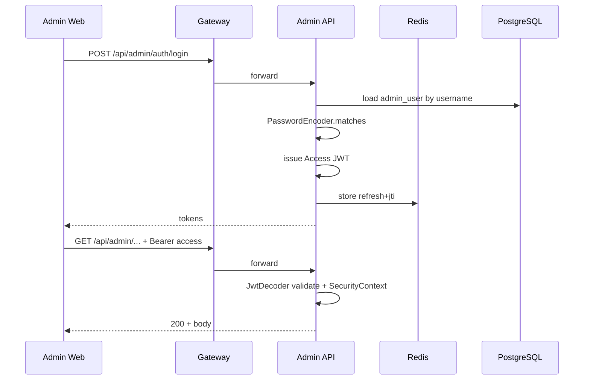

# 阶段 4A：Admin 认证体系详细设计

## 1. 文档元信息与边界

| 项 | 说明 |
| --- | --- |
| 性质 | **设计文档**：界定后台登录、JWT、Refresh Token、Redis、Spring Security 的职责边界与约定 |
| **阶段状态** | **阶段 4A 已收口并关闭**；**阶段 4B（Admin 认证基础链路）已实现**。本文「已定案结论」与「4B 落地状态」与仓库代码、`application*.yml`、Swagger 对齐 |
| 读者 | 后端开发与评审 |
| 关联前置 | 阶段 2B 首批表；阶段 3A/3B 持久层；**持久层真实 PostgreSQL 回归验证**（长期）已就绪 |

本文约定均以 **Admin API（`admin` 模块）** 为中心；Site 前台认证保持 **`TokenAudience.SITE`** 分离思路，可在后续独立成章。

---

## 2. 设计目标与非目标

### 2.1 目标

1. **账号口令**：使用 Spring Security 官方的 **`PasswordEncoder`**（默认 **`BCryptPasswordEncoder`** 或通过 **`DelegatingPasswordEncoder`** 预留算法升级）存储与校验 **`admin_user`** 口令摘要。
2. **访问令牌**：签发短命 **Access JWT**，受众 **`ADMIN`**（与现有 **`TokenAudience`** 对齐），用于无状态调用后台 API。
3. **刷新令牌**：服务端可控的 **Refresh Token** 机制（推荐 **不透明令牌 + Redis**），支持轮换（rotation）、吊销与设备级生命周期管理。
4. **会话状态**：Redis 承载 refresh 绑定及吊销集合；**不**引入服务端 HTTP Session 作为主要模型（保持 API 无状态，Redis 仅存令牌治理数据）。
5. **安全边界**：明确 **`gateway`** 与 **`admin`** 谁校验 JWT、错误响应口径、以及与 **`auth`** 模块已有抽象的衔接。

### 2.2 非目标（推迟）

- 完整 RBAC 授权模型实现（路由级权限缓存等可在 4B/5x）。
- MFA、OAuth2 第三方登录、密码找回流程。
- 网关层完整 JWT 校验策略落地（本文仅给选项与推荐）。

---

## 3. 威胁与假设（简述）

| 风险 | 设计对策 |
| --- | --- |
| 口令数据库泄露 | 仅存储 **`PasswordEncoder`** 摘要；禁止明文或可逆加密 |
| 访问令牌窃取（XSS等） | 短命 Access JWT；HTTPS；前端存储策略由 Admin Web 另行约束 |
| Refresh 重放 | Redis 绑定 **账户 + 设备指纹（可选）+ jti**；轮换使旧 refresh 一次性失效 |
| 暴力破解登录 | 速率限制（网关或 Admin）、账户锁定策略（后续可选） |

**假设：** Admin Web 与 Admin API 同城延迟可忽略；时钟使用 NTP；PostgreSQL / Redis 可达性与备份由运维保障。

---

## 4. 组件与职责

```text
Admin Web (浏览器)
       │ HTTPS
       ▼
Gateway (:8080)           ── 可选：转发 / 粗粒度限流 / 不传密钥
       │
       ▼
Admin API (:8081)
  ├─ Spring Security      ── 登录端点放行；其余业务 API：JWT 认证
  ├─ PasswordEncoder      ── 注册/改密哈希；登录校验 matches()
  ├─ JwtEncoder/JwtDecoder── Access JWT 签发与校验（对称或非对称密钥）
  ├─ RefreshTokenStore    ── Redis：refresh ↔ subject / jti / exp
  └─ admin_user Mapper    ── 查询活跃用户、登录审计字段更新（后续）

Redis                     ── refresh、吊销列表（可选）、登录速率计数（可选）

PostgreSQL                ── admin_user（口令哈希）、审计列（可选扩展）
```

**`auth` 模块**：继续承载 **`TokenClaims`、`JwtProperties`、`AuthenticatedUser`、`AuthContext`** 等与 Audience 无关的 **JWT 语义抽象**；**不**存放具体 **`AdminUserEntity`**。

---

## 5. Spring Security 选型说明

Spring Security 提供 **`PasswordEncoder`** 用于口令摘要算法选择与 **`matches`** 校验；在 Servlet / WebFlux 栈下可与 **`AuthenticationManager`**、过滤器链协同，亦可与 **OAuth2 Resource Server**（JWT）集成以实现标准化 JWT 校验。

### 5.1 口令：`PasswordEncoder`

- **存储格式**：数据库 **`password_hash`** 列存放 **`PasswordEncoder`** 编码后的字符串（含算法前缀时使用 **`DelegatingPasswordEncoder`**）。
- **校验**：登录时用 **`encoder.matches(rawPassword, storedHash)`**；禁止手写常量时间比较绕过框架。
- **升级**：未来算法轮换可通过 **`DelegatingPasswordEncoder`** 兼容旧前缀并在登录成功后 **按需重哈希**（可选流程）。

### 5.2 请求认证：JWT 资源服务器 vs 自定义过滤器

| 方案 | 适用 |
| --- | --- |
| **OAuth2 Resource Server（JWT）** | Spring Boot 官方 **`spring-boot-starter-oauth2-resource-server`**：`JwtDecoder` 校验签名与 **`exp`**，便于与标准 JWT 对齐 |
| **自定义 `OncePerRequestFilter` + `JwtDecoder`** | 需要深度定制错误体、与 **`AuthContext`** 线程绑定方式时用 |

**推荐默认路径：** 以 **Resource Server JWT** 为主干，`JwtDecoder` 仍可由 **`auth`** 模块暴露 Bean 或由 **`admin`** 装配；仅在确有缺口时再下沉过滤器逻辑。

### 5.3 `Authentication` 对象

JWT 校验成功后，构造 **`Authentication`**（例如 **`JwtAuthenticationToken`** 或 **`UsernamePasswordAuthenticationToken`**），**Principal** 使用 **`AuthenticatedUser`**（或兼容 **`UserDetails`** 的适配器），并写入 **`SecurityContext`**；业务层优先读 **`AuthContext`**，避免直连 **`SecurityContextHolder`** 泛滥。

---

## 6. 令牌模型

### 6.1 Access JWT（短命）

| 字段 | 定案 |
| --- | --- |
| **`sub` / `aud` / `iss` / `iat` / `exp` / `jti`** | 标准声明；**Access TTL = 15 分钟**（配置 **`security.jwt.access-token-ttl`**） |
| **`token_type`** | **`ADMIN`**（与 **`TokenAudience.ADMIN`** 对齐） |
| **`admin_user_id` / `username` / `session_id`** | 业务载荷 |
| **`permissions`** | **禁止写入 JWT** |
| **`roles`** | **4B 认证链路不作为依赖**（RBAC 阶段再决定是否写入少量 **`roleCodes`**） |

密钥：**对称 HS256**（环境变量 **`SECURITY_JWT_SECRET`** / **`security.jwt.secret`**）；私钥签发、网关验签、RS256 等演进另行评估。

### 6.2 Refresh Token（长命、服务端约束）

**推荐：** **不透明随机串（UUID / 加密随机字节 Base64URL）**，仅存摘要或与明文映射关系于 Redis；数据库可选仅存轮换链审计（后续）。

| 属性 | 说明 |
| --- | --- |
| TTL | 例如 **7–30 天**（产品决策） |
| 绑定 | **`admin_user.id` + jti（refresh）**；可选 **`device_id`** |
| 轮换 | 每次刷新签发 **新 refresh**，旧条目删除或标记失效 |
| 吊销 | 登出 / 改密 / 风控：`DEL` Redis key 或写入 **`revoked`** 集合 |

**不推荐**把长期 Refresh 做成第二个 JWT **除非**团队愿意承担 JWT 吊销难题（黑名单体积与校验开销）。

---

## 7. Redis 键空间约定（已定稿 · 与实现对齐）

统一前缀：**`auth:admin:`**（不按环境追加别名；环境隔离依赖 Redis DB / 实例边界）。

| Key 模式 | 值语义 | TTL |
| --- | --- | --- |
| **`auth:admin:session:{sessionId}`** | Hash：**`adminUserId`**、**`username`**、**`refreshTokenHash`**（SHA-256 hex）、**`issuedAtMillis`**、**`expireAtMillis`**（会话绝对到期锚点） | 直至 **`expireAt`** |
| **`auth:admin:user:sessions:{adminUserId}`** | Set：**`sessionId`** 列表（便于后续会话治理扩展） | 成员随会话删除维护 |
| **`auth:admin:refresh:{sha256(refresh)}`** | 指向 **`sessionId`**（当前有效的 Refresh 映射） | 会话剩余寿命 |
| **`auth:admin:refresh-replay:{sha256(oldRefresh)}`** | 指向 **`sessionId`**（轮换后被废除的旧 Refresh **墓碑**，用于基础版 **Replay 检测**） | 会话剩余寿命 |

生产需开启 **Redis ACL** 与连接 TLS（运维项）。

> **Replay（4B 基础版）**：轮换成功后旧 Refresh 写入 **`refresh-replay:*`**；若同一旧 Refresh **再次被提交**，判定异常并重拳 **`purgeSession`**（吊销服务端会话状态）。

---

## 8. 流程说明（逻辑）

### 8.1 登录（用户名 + 口令）

1. Client **`POST`** 登录请求（HTTPS）。
2. **`admin`** 根据 **`username`** 查 **`admin_user`**（**仅活跃用户**，逻辑删除过滤）。
3. **`PasswordEncoder.matches`**；失败返回 **401**（模糊错误信息，避免枚举用户名）。
4. 签发 **Access JWT**；生成 **Refresh**，写入 Redis。
5. 响应体返回 **Access JWT**、**`expires_in`**、管理员摘要；**Refresh Token 仅写入 HttpOnly Cookie**（**不下发 JSON**，前端 JS 不可读）。

### 8.2 刷新

1. Client 携带 refresh。
2. 校验 Redis 存在性与 TTL；可选校验绑定 **`sub`**。
3. **轮换**：删除旧 refresh 记录，写入新 refresh；签发新 Access JWT。
4. 若检测到重复使用已吊销的旧 refresh（可选风控）：吊销该用户全部 refresh。

### 8.3 登出

1. 删除 Redis 中 refresh。
2. （可选）Access **`jti`** 写入黑名单直至过期。

### 8.4 示意图（Mermaid）



---

## 9. 与 Gateway 的职责划分（选项）

| 模式 | 描述 |
| --- | --- |
| **A. 网关不校验 JWT（推荐起步）** | Gateway 只做路由与健康检查；**`admin`** 完整校验 JWT，密钥不外泄到网关 |
| **B. 网关校验 JWT** | Gateway 配置 **`JwtDecoder`（公钥）**，提早拒绝非法请求；需密钥管理与时钟一致性 |

阶段 4A **文档层面**默认 **模式 A**；模式 B 作为演进备注。

---

## 10. 错误与安全响应

- **401 Unauthorized**：未认证或令牌无效（模糊消息：**「未认证或令牌无效」**）。
- **403 Forbidden**：已认证但权限不足（后续 RBAC）。
- **429 Too Many Requests**：登录速率限制触发。
- **日志**：记录 **`request_id`**、用户 ID（若已知）、结果码；**禁止**在日志中输出明文口令或 refresh 明文。

---

## 11. 与现有 `auth` 模块的衔接

| 现有构件 | 阶段 4A 用法 |
| --- | --- |
| **`JwtProperties`** | issuer、TTL、密钥引用（环境变量） |
| **`TokenAudience.ADMIN`** | Access JWT **`aud`** |
| **`TokenClaims` / `AuthenticatedUser`** | 校验通过后填充 **`AuthContext`** |
| **`TokenService`**（若已有签发草稿） | 扩展为签发 Access；refresh **不强行塞入** JWT |

---

## 12. 数据库与迁移（设计层）

本阶段 **不改表结构**；实现阶段如需 **`last_login_at`**、**`failed_attempts`** 等字段，应通过 **新 Flyway migration** 与 **数据字典** 同步更新。

---

## 13. 已定案结论（阶段 4A 收口）

以下内容取代历史上「待确认 / 可选 / 开放问题」，作为 **唯一口径**：

1. **登录标识（V1）**：仅 **`username + password`**；**不支持** email / phone 作为主标识登录。
2. **密码**：Spring Security **`BCryptPasswordEncoder`**；DB 仅存哈希；登录 **`matches`**；**口令最大长度**由 **`security.auth.admin-login-max-password-length`** 集中约束（请求校验 + 服务端兜底）。
3. **Access JWT**：**15 分钟** TTL；**`Authorization: Bearer`**；Claims 至少包含 **`sub`、`jti`、`aud`、`iss`、`iat`、`exp`、`token_type=ADMIN`、`admin_user_id`、`username`、`session_id`**；**`permissions` 不入 JWT**；**4B 不以 `roles` 作为认证链路依赖**。
4. **Refresh**：**不透明随机串**；**Redis** 持久化；**绝对 TTL = 7 天**（轮换 **不延长** 该锚点）；**HttpOnly Cookie** 下发，`Secure`/`SameSite` 见配置 **`security.auth.refresh-cookie-*`**（本地 HTTP 允许 **`Secure=false`**）。
5. **Rotation**：每次刷新校验 Refresh → 签发 **新 Refresh + 新 Access** → **旧 Refresh 立即失效**；若捕获 **旧 Refresh 重放**，**吊销服务端会话状态**。
6. **登出**：删除会话 Redis 状态并 **清除 Refresh Cookie**；**不做 Access 黑名单（4B）**，依赖 Access 短命自然过期。
7. **多端**：**允许并行会话**；每次登录新建 **`sessionId`**；**不做设备上限 / 踢下线策略（4B）**。
8. **JWT 算法**：**HS256**；密钥 **环境变量注入**，禁止硬编码。
9. **Spring Security**：OAuth2 Resource Server **JWT + `JwtDecoder`**；**`STATELESS`**；登录三接口放行；其余 **`/api/admin/**`** 默认需认证。
10. **Gateway（4B）**：**不做 JWT 校验**，只做路由接入。

---

## 14. HTTP Cookie（Refresh）策略摘要

| 项 | 定案 |
| --- | --- |
| **`HttpOnly`** | **`true`** |
| **`Secure`** | 生产 **`true`**；本地 HTTP 可通过 **`SECURITY_REFRESH_COOKIE_SECURE` / `security.auth.refresh-cookie-secure`** 置 **`false`** |
| **`SameSite`** | 生产 **`Strict`**（配置项 **`security.auth.refresh-cookie-same-site`**） |
| **`Path`** | **`/api/admin/auth`**（避免站点其它路径携带 Refresh） |

---

## 15. Spring 配置项（命名与实现对齐）

**JWT（`security.jwt.*`）**：`issuer`、`audience`、`secret`（**非空才会装配 JWT Bean**，参见 §17）、`access-token-ttl`。  
**认证会话（`security.auth.*`）**：`refresh-token-ttl`、`refresh-cookie-name`、`refresh-cookie-path`、`refresh-cookie-secure`、`refresh-cookie-same-site`、`admin-login-max-password-length`。

**绑定类对齐**：`security.jwt.*` → **`JwtProperties`**（**`auth`**）；`security.auth.*` → **`AdminAuthProperties`**（**`admin/properties`**）。

环境变量推荐使用：`SECURITY_JWT_SECRET`、`SECURITY_REFRESH_COOKIE_SECURE`（布尔）。

---

## 16. JWT Bean 装配说明（跨应用）

`auth` 模块中的 **`AuthConfig`** 通过内嵌配置类并配合 **`JwtBeansEnabledCondition`**：**仅当 `security.jwt.secret` 非空** 时才注册 **`JwtEncoder` / `JwtDecoder` / `TokenService`**，以便 **`site-app`** 等在尚未配置密钥时仍可正常编译与冒烟测试；**Admin 运行时必须配置密钥**，否则认证链路无法工作。

---

## 17. 文档索引

- [持久层真实 PostgreSQL 验证说明](../数据文档/持久层真实PostgreSQL验证说明.md)
- [数据库模型设计 V1](./数据库模型设计V1.md) · Admin RBAC 表
- [Java 持久层设计 V1](../Java持久层设计V1.md)
- `services/website-services/auth` · JWT 抽象与签发实现
- `services/website-services/admin` · Spring Security（**`AdminSecurityConfig`**）/ 登录刷新登出 / Redis Refresh

---

## 18. 阶段 4B 落地状态（实现核对）

| 类别 | 状态 |
| --- | --- |
| **接口** | **`POST /api/admin/auth/login`**、**`POST /api/admin/auth/refresh`**、**`POST /api/admin/auth/logout`**；其它 **`/api/admin/**`** 默认 Bearer 保护 |
| **Swagger** | **`Admin Auth`** 分组可见；受保护示例接口 **`GET /api/admin/ping`** 使用 **`adminBearer` scheme** |
| **Redis** | **`RedisAdminRefreshSessionServiceImpl`**；缺 **`RedisConnectionFactory`**（如单元测试排除 Redis）时 **`AdminRefreshSessionTestBeans`** 仅向 **测试** 上下文注册 **`InMemoryAdminRefreshSessionServiceImpl`**（语义对齐，**禁止**视作生产替身） |
| **测试** | **`JwtTokenServiceTest`**、`InMemoryAdminRefreshSessionServiceImplTest`、`AdminAuthMvcTest`；默认 **`mvn test`** 不依赖本机 Redis |

---

**结论：**阶段 4A 已完成决策收口并 **正式关闭**；阶段 4B 已实现 **Admin 认证最小闭环**。下一步进入 **阶段 4C：Admin 认证真实联调与安全边界验证**（HTTPS/Cookie、网关转发头、Redis 会话观测与风控加固等）。
