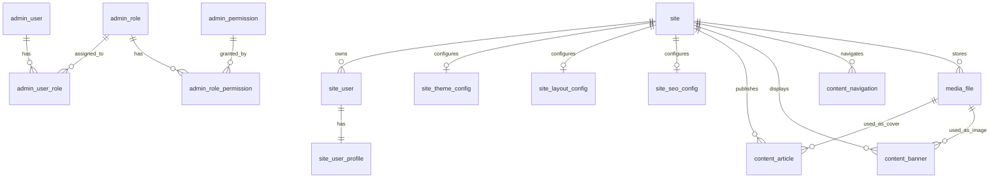

# website-services 数据库模型设计 V1

阶段：2A 数据库模型与规范设计（蓝图） + **2B Flyway 首批表结构（已落地 SQL）+ 数据字典**  
状态：设计文档持续有效；首批 migration 已由 **阶段 2B** 落地为 Flyway 脚本（仍无 Java 实体 / Mapper / CRUD）。**已落地表的字段级权威说明见 `docs/数据字典/`**（与设计文档双线维护）。

## 1. 目标与边界

本文档为 `services/website-services` 数据库落地提供模型蓝图与规范，重点确认多站点隔离、用户体系边界、公共字段规范、首批建表范围与暂缓范围。

阶段 2A 只做设计；**阶段 2B 仅落地 Flyway SQL 与表结构**，仍不做：

- 不新增 Mapper / Repository / Service / Controller。
- 不实现 CRUD、登录注册、权限业务。
- 不落地 car/cake 具体业务表、`site_user_auth`、`site_*_config`、`media_file`。
- 不提前完整实现内容管理系统。

## 2. 架构上下文

当前后端模块边界：

- `gateway`：统一入口，不接数据库。
- `admin`：后台管理服务，承载后台用户、角色、权限与平台管理能力。
- `auth`：公共认证基础能力，只放 JWT、认证上下文、当前用户抽象，不承载具体用户表。
- `common`：通用响应、错误码、异常、分页等基础模型。
- `config`：站点配置业务能力。
- `infra`：PostgreSQL、Redis、MinIO、MyBatis-Plus、Flyway 等基础设施接入。
- `agent`：AI 调用客户端能力，不直接依赖数据库、Redis、MinIO。
- `site/site-app`：前台站点 API 启动模块。
- `site/site-core`：前台站点公共核心能力与统一 site 用户体系。
- `site/site-car`、`site/site-cake`：行业业务模块骨架。

核心原则：

- Admin 用户体系与 Site 用户体系必须隔离。
- `auth` 不定义 `admin_user`、`site_user` 或任何具体用户实体。
- Site 用户不按 car/cake 分表，统一使用 `site_user + site_id` 隔离。
- 所有后续表结构变更必须通过 Flyway migration 落地。

## 3. 数据库全局规范

### 3.1 表命名规范

推荐规则：

- 表名统一使用小写字母。
- 单词之间统一使用下划线。
- 表名使用业务域前缀，避免跨域混淆。
- 关联表使用 `<主实体>_<关联实体>` 命名。
- 不使用复数表名。

示例：

| 业务域 | 表名示例 | 说明 |
| --- | --- | --- |
| 平台站点 | `site`、`site_domain` | 站点主数据与域名绑定 |
| 后台管理 | `admin_user`、`admin_role`、`admin_permission` | 后台用户与 RBAC |
| 前台用户 | `site_user`、`site_user_profile`、`site_user_auth` | 前台统一用户体系 |
| 站点配置 | `site_theme_config`、`site_layout_config`、`site_seo_config` | 站点级配置 |
| 内容 | `content_article`、`content_banner`、`content_navigation` | 站点内容 |
| 媒体 | `media_file` | MinIO 对象元数据 |
| 行业业务 | `car_*`、`cake_*` | 未来行业业务表 |

结论：统一采用“小写 + 下划线 + 业务域前缀”。`site` 是平台核心主数据表，因其本身就是核心域名词，不再额外加 `platform_` 前缀。

### 3.2 主键策略

候选方案：

| 方案 | 优点 | 缺点 | 判断 |
| --- | --- | --- | --- |
| `bigint` 数据库自增 / identity | 简单、可读、PostgreSQL 原生支持、MyBatis-Plus 适配成本低 | 跨库分片或多主写入时需要额外方案 | 推荐 V1 使用 |
| UUID | 分布式友好，不依赖数据库序列 | 索引更大，可读性差，对业务排查不友好 | 暂不推荐默认使用 |
| 雪花 ID / 分布式 ID | 分布式友好，仍保持 `bigint` | 需要机器号、时钟、部署规范，当前阶段复杂度偏高 | 作为后续演进备选 |

推荐方案：

- V1 默认使用 `bigint` 主键。
- PostgreSQL 中建议使用 identity / sequence 生成。
- MyBatis-Plus 后续实体建议使用 `IdType.AUTO`。
- 不把业务含义编码进主键。

理由：

- 当前是单 PostgreSQL 实例的多模块后端，不需要提前引入分布式 ID 基础设施。
- `bigint` 对索引、关联、排查和导入导出都更友好。
- 后续如进入多库、多区域或高并发分布式写入，再评估切换为 MyBatis-Plus `ASSIGN_ID` 或独立 ID 服务。

### 3.3 公共审计字段

基础业务表建议统一包含：

| 字段 | 类型建议 | 必须性 | 说明 |
| --- | --- | --- | --- |
| `id` | `bigint` | 必须 | 主键 |
| `created_at` | `timestamptz` | 必须 | 创建时间 |
| `created_by` | `bigint` | 建议 | 创建人 ID，系统初始化或匿名场景可为空 |
| `updated_at` | `timestamptz` | 必须 | 更新时间 |
| `updated_by` | `bigint` | 建议 | 更新人 ID，系统任务可为空 |
| `deleted` | `boolean` | 必须 | 软删除标记 |
| `deleted_at` | `timestamptz` | 建议 | 删除时间 |
| `version` | `integer` | 建议 | 乐观锁版本 |

必须包含公共字段的表：

- 用户表：`admin_user`、`site_user`、`site_user_profile`。
- RBAC 表：`admin_role`、`admin_permission`。
- 站点主数据：`site`。
- 站点配置表：`site_theme_config`、`site_layout_config`、`site_seo_config`。
- 内容与媒体表：`content_article`、`content_banner`、`content_navigation`、`media_file`。
- 未来 car/cake 业务主表。

可简化公共字段的表：

- 纯关联表：`admin_user_role`、`admin_role_permission` 可保留 `id`、`created_at`、`created_by`、`deleted`，`updated_at`/`version` 可选。
- 字典型静态表可不使用软删除，但当前 V1 不建议提前设计复杂字典表。

软删除建议：

- V1 默认采用软删除。
- 所有唯一约束需要考虑 `deleted`，避免软删除数据阻塞再次创建。
- 后续 MyBatis-Plus 可统一使用逻辑删除配置。

自动填充准备：

- `created_at`、`updated_at` 后续由 MyBatis-Plus MetaObjectHandler 自动填充。
- `created_by`、`updated_by` 后续由 Admin/Site 当前用户上下文填充。
- `version` 后续可接入 MyBatis-Plus 乐观锁插件。

### 3.4 状态字段规范

推荐规则：

- 复杂状态统一使用枚举码字段，不用散落布尔值。
- 简单开关可以使用 `enabled`。
- 发布流程使用专用状态字段，例如 `publish_status`。
- 用户账号状态使用 `status`，不要只用 `enabled` 表达全部含义。

建议状态字段：

| 字段 | 适用范围 | 示例值 |
| --- | --- | --- |
| `status` | 用户、站点、角色、业务主实体 | `ACTIVE`、`DISABLED`、`LOCKED` |
| `enabled` | 简单开关能力 | `true`、`false` |
| `publish_status` | 内容发布流程 | `DRAFT`、`PUBLISHED`、`ARCHIVED` |
| `verify_status` | 审核流程 | `PENDING`、`APPROVED`、`REJECTED` |

结论：

- 用户、站点、内容等核心表使用状态枚举码。
- 只有明确二值开关才使用 `enabled`。
- Java 层后续用枚举统一管理，不在各业务中散落字符串常量。

### 3.5 唯一约束与索引原则

基础原则：

- 唯一约束必须体现业务隔离边界。
- 多站点数据优先使用 `site_id + 业务字段` 的组合唯一索引。
- 软删除表的唯一约束需要纳入 `deleted` 或使用 PostgreSQL partial unique index。
- 高频查询字段必须建索引，但不提前为未知查询过度建索引。

关键唯一约束建议：

| 表 | 唯一规则 | 说明 |
| --- | --- | --- |
| `site` | `site_code` 唯一 | 全平台站点编码唯一 |
| `site` | `domain` 或 `site_domain.domain` 唯一 | 站点访问域名唯一 |
| `admin_user` | `username` 唯一 | 后台管理员用户名全平台唯一 |
| `admin_user` | `email` 可唯一 | 如作为登录标识则唯一 |
| `site_user` | `site_id + username` 唯一 | 同站点内用户名唯一 |
| `site_user` | `site_id + email` 可唯一 | 同站点内邮箱唯一，空值需特殊处理 |
| `site_user` | `site_id + phone` 可唯一 | 同站点内手机号唯一，空值需特殊处理 |
| `admin_role` | `role_code` 唯一 | 后台角色编码全平台唯一 |
| `admin_permission` | `permission_code` 唯一 | 后台权限编码全平台唯一 |
| `site_theme_config` | `site_id` 唯一 | 一站点一条当前主题配置 |

索引建议：

- 所有外键关联字段建立普通索引，例如 `site_id`、`user_id`、`role_id`。
- 内容表按 `site_id + publish_status + published_at` 建组合索引。
- 媒体表按 `site_id + storage_key` 建索引。
- 不建议在 V1 为 car/cake 未落地业务提前设计复杂索引。

### 3.6 多站点隔离规范

明确建议：

- 当前不引入通用 `tenant_id`。
- 平台级多租户边界统一使用 `site_id`。
- `site` 是平台内的租户/站点主数据。
- car/cake 是站点类型或业务模块，不是用户隔离维度。
- 未来 car/cake 业务表必须通过 `site_id` 归属到具体站点。

为什么不引入 `tenant_id`：

- 当前产品语义是“多站点平台”，不是面向多公司、多组织、多租户 SaaS 的复杂租户体系。
- `tenant_id` 与 `site_id` 并存会增加设计歧义。
- 未来如果出现集团、代理商、企业组织等上层租户，再在 `site` 之上引入 `organization` 或 `tenant`，而不是现在提前加字段。

平台、站点、业务模块关系：

```text
Platform
  └── site
      ├── site_type = CAR  -> site-car 模块承载行业能力
      ├── site_type = CAKE -> site-cake 模块承载行业能力
      └── site_type = ...  -> 后续新增行业模块
```

必须带 `site_id` 的表：

- `site_user`
- `site_user_profile`
- `site_user_auth`
- `site_theme_config`
- `site_layout_config`
- `site_seo_config`
- `content_article`
- `content_banner`
- `content_navigation`
- `media_file` 中的站点私有素材
- 未来 `car_*`、`cake_*` 业务表

不应带 `site_id` 的平台级表：

- `site` 本身
- `site_domain` 如果按域名归属站点，可带 `site_id`，但它不是站点隔离数据，而是站点绑定数据
- `admin_user`
- `admin_role`
- `admin_permission`
- `admin_user_role`
- `admin_role_permission`
- 平台全局配置表
- 平台公共素材库表，如果后续独立设计

结论：

- V1 以 `site_id` 作为站点级数据隔离标准。
- 不引入 `tenant_id`。
- 不为 car/cake 分别创建用户表。

## 4. 核心领域模型设计

### 4.1 站点模型

#### `site`

`site` 是平台内每个前台站点的主数据，是多站点隔离和行业能力挂载的根。

建议字段：

| 字段 | 说明 |
| --- | --- |
| `id` | 站点主键 |
| `site_code` | 站点编码，全平台唯一，用于配置、路由、数据隔离和日志排查 |
| `site_name` | 站点名称 |
| `site_type` | 站点类型，例如 `CAR`、`CAKE` |
| `status` | 站点状态，例如 `ACTIVE`、`DISABLED` |
| `default_domain` | 默认访问域名，可后续拆到 `site_domain` |
| `description` | 站点说明 |
| 公共审计字段 | `created_at`、`updated_at` 等 |

`site_code` 的作用：

- 作为人可读、稳定的站点编码。
- 用于前端路由、配置读取、日志定位、运营后台检索。
- 不替代主键，业务关联仍优先使用 `site_id`。

car/cake 与 site 的关系：

- car/cake 不代表不同用户体系。
- car/cake 是 `site.site_type` 的取值，也是后端 `site-car` / `site-cake` 模块承载的行业能力。
- 同一个 `site_user` 表通过 `site_id` 隔离不同站点用户。

#### `site_domain`

V1 可暂缓建表。

当一个站点需要多个域名、域名审核、主域名切换、历史域名保留时，再引入：

| 字段 | 说明 |
| --- | --- |
| `id` | 主键 |
| `site_id` | 所属站点 |
| `domain` | 域名，全平台唯一 |
| `primary_domain` | 是否主域名 |
| `status` | 绑定状态 |

推荐：首批可先在 `site.default_domain` 保留单域名能力，后续再拆 `site_domain`。

### 4.2 Admin 后台管理员模型

Admin 用户体系服务后台管理人员，必须与前台 `site_user` 隔离。

隔离原因：

- 登录入口不同。
- 权限模型不同。
- 数据访问范围不同。
- 生命周期与安全策略不同。
- 后台管理员不属于某个具体站点用户。

#### `admin_user`

建议字段：

| 字段 | 说明 |
| --- | --- |
| `id` | 管理员主键 |
| `username` | 登录用户名，全平台唯一 |
| `email` | 邮箱，可作为登录标识 |
| `phone` | 手机号，可选 |
| `password_hash` | 密码哈希，不保存明文 |
| `display_name` | 显示名称 |
| `status` | `ACTIVE`、`DISABLED`、`LOCKED` |
| `last_login_at` | 最近登录时间 |
| 公共审计字段 | 创建、更新、删除、版本 |

#### `admin_role`

建议字段：

| 字段 | 说明 |
| --- | --- |
| `id` | 角色主键 |
| `role_code` | 角色编码，全平台唯一 |
| `role_name` | 角色名称 |
| `description` | 说明 |
| `status` | 角色状态 |
| 公共审计字段 | 创建、更新、删除、版本 |

#### `admin_permission`

建议字段：

| 字段 | 说明 |
| --- | --- |
| `id` | 权限主键 |
| `permission_code` | 权限编码，全平台唯一 |
| `permission_name` | 权限名称 |
| `resource_type` | 资源类型，例如 `MENU`、`API`、`ACTION` |
| `resource_key` | 资源标识 |
| `description` | 说明 |
| `status` | 权限状态 |
| 公共审计字段 | 创建、更新、删除、版本 |

#### `admin_user_role`

管理员与角色多对多关联。

建议字段：

| 字段 | 说明 |
| --- | --- |
| `id` | 主键 |
| `admin_user_id` | 管理员 ID |
| `admin_role_id` | 角色 ID |
| `created_at` | 创建时间 |
| `created_by` | 创建人 |
| `deleted` | 软删除 |

唯一约束建议：`admin_user_id + admin_role_id + deleted`。

#### `admin_role_permission`

角色与权限多对多关联。

建议字段：

| 字段 | 说明 |
| --- | --- |
| `id` | 主键 |
| `admin_role_id` | 角色 ID |
| `admin_permission_id` | 权限 ID |
| `created_at` | 创建时间 |
| `created_by` | 创建人 |
| `deleted` | 软删除 |

唯一约束建议：`admin_role_id + admin_permission_id + deleted`。

RBAC 首期建议：

- 建议首批落地 `admin_user`。
- 如后台管理需要立即分角色授权，则同时落地 `admin_role`、`admin_permission`、`admin_user_role`、`admin_role_permission`。
- 如果首期只需要超级管理员单账号，可以先只建 `admin_user`，RBAC 表放到第二批。

本设计推荐：首批 migration 设计时包含 RBAC 全套表，但只放基础结构，不初始化复杂权限数据。

### 4.3 Site 前台用户模型

#### `site_user`

`site_user` 是所有前台站点统一用户表，通过 `site_id` 归属到具体站点。

为什么统一建表：

- car/cake 用户本质都是前台访客或会员。
- 统一表便于认证、预约、咨询、内容互动等通用能力复用。
- 行业差异应放在行业业务表或 profile 扩展中，不应拆成 `car_user`、`cake_user`。

建议字段：

| 字段 | 说明 |
| --- | --- |
| `id` | 用户主键 |
| `site_id` | 所属站点 |
| `username` | 用户名，可选 |
| `email` | 邮箱，可选 |
| `phone` | 手机号，可选 |
| `password_hash` | 密码哈希，如启用密码登录 |
| `status` | `ACTIVE`、`DISABLED`、`LOCKED` |
| `last_login_at` | 最近登录时间 |
| 公共审计字段 | 创建、更新、删除、版本 |

唯一约束建议：

- `site_id + username + deleted`
- `site_id + email + deleted`
- `site_id + phone + deleted`

登录标识建议：

- V1 允许 username/email/phone 作为扩展方向。
- 真正登录实现阶段再确认首期启用哪一种。
- 不建议把 car/cake 作为登录标识维度。

#### `site_user_profile`

用户资料表，与认证信息拆开，减少敏感字段与展示资料耦合。

建议字段：

| 字段 | 说明 |
| --- | --- |
| `id` | 主键 |
| `site_id` | 所属站点 |
| `site_user_id` | 前台用户 ID |
| `display_name` | 显示名称 |
| `avatar_url` | 头像 URL 或媒体引用 |
| `gender` | 性别，可选 |
| `birthday` | 生日，可选 |
| `locale` | 语言偏好 |
| `timezone` | 时区 |
| 公共审计字段 | 创建、更新、删除、版本 |

唯一约束建议：`site_user_id` 唯一。

#### `site_user_auth`

建议作为后续扩展表，不作为首批必须建表。

适用场景：

- 一个用户绑定多个认证方式。
- OAuth / LINE / Google 等第三方登录。
- 手机验证码、邮箱验证码、密码登录并存。
- 后续需要认证凭据独立生命周期。

建议字段方向：

| 字段 | 说明 |
| --- | --- |
| `id` | 主键 |
| `site_id` | 所属站点 |
| `site_user_id` | 前台用户 ID |
| `auth_type` | `PASSWORD`、`EMAIL`、`PHONE`、`OAUTH` |
| `identifier` | 登录标识 |
| `credential_hash` | 凭据哈希，可为空 |
| `provider` | 第三方提供方 |
| `status` | 状态 |

推荐：如果阶段 2B 目标只是建立基础用户模型，可暂不建 `site_user_auth`；若登录体系会马上支持多登录方式，则首批建。

### 4.4 站点配置模型方向

站点配置属于 `config` 能力域，所有配置表必须带 `site_id`。

#### `site_theme_config`

建议：一站点一条当前主题配置。

字段方向：

- `site_id`
- `theme_code`
- `primary_color`
- `secondary_color`
- `font_family`
- `config_json`

结构化列与 JSON 取舍：

- 高频检索、筛选、展示的字段使用结构化列，例如 `theme_code`。
- 变化快、前端展示强相关的配置放 `config_json`。
- 不把全部配置无脑塞进 JSON，否则后续检索和迁移困难。

#### `site_layout_config`

建议：一站点一条当前布局配置，或后续按页面维度扩展。

字段方向：

- `site_id`
- `layout_code`
- `page_key`
- `config_json`

V1 建议暂不首批落地，等前端页面配置模型稳定后再建。

#### `site_seo_config`

建议：一站点一条默认 SEO 配置，后续内容页可有自己的 SEO 字段。

字段方向：

- `site_id`
- `title`
- `description`
- `keywords`
- `og_image_media_id`
- `config_json`

V1 建议可暂缓，除非首期就要后台配置 SEO。

### 4.5 内容与媒体模型方向

#### `content_article`

文章/页面内容表，必须带 `site_id`。

字段方向：

- `site_id`
- `title`
- `slug`
- `summary`
- `content`
- `cover_media_id`
- `publish_status`
- `published_at`

唯一约束建议：`site_id + slug + deleted`。

#### `content_banner`

Banner 表，必须带 `site_id`。

字段方向：

- `site_id`
- `title`
- `image_media_id`
- `link_url`
- `sort_order`
- `enabled`

#### `content_navigation`

导航表，必须带 `site_id`。

字段方向：

- `site_id`
- `parent_id`
- `label`
- `link_url`
- `sort_order`
- `enabled`

#### `media_file`

MinIO / S3 对象元数据表，用于记录文件与对象存储路径的关系。

字段方向：

| 字段 | 说明 |
| --- | --- |
| `id` | 主键 |
| `site_id` | 站点 ID，站点私有素材必填，平台公共素材可为空 |
| `bucket` | 对象存储桶 |
| `object_key` | MinIO 对象 key |
| `original_filename` | 原始文件名 |
| `content_type` | MIME 类型 |
| `file_size` | 文件大小 |
| `sha256` | 文件哈希，用于去重或校验 |
| `visibility` | `PRIVATE`、`PUBLIC` |
| `status` | 文件状态 |
| 公共审计字段 | 创建、更新、删除、版本 |

是否都带 `site_id`：

- 站点私有素材必须带 `site_id`。
- 平台共用素材可以 `site_id` 为空，或后续单独设计平台素材库。

推荐：`media_file` 不作为第一批必建表，除非阶段 2B 同时要落地文件上传基础能力。

## 5. 首批建议建表范围

### 5.1 第一批建议通过 Flyway 建立的表

推荐第一批：

| 表 | 推荐程度 | 原因 |
| --- | --- | --- |
| `site` | 必建 | 多站点平台根模型，所有站点级数据都依赖它 |
| `admin_user` | 必建 | 后台管理入口的基础身份模型 |
| `admin_role` | 建议首批 | RBAC 基础结构，避免后续改造 admin_user |
| `admin_permission` | 建议首批 | 权限编码与菜单/API/action 后续都依赖 |
| `admin_user_role` | 建议首批 | 管理员与角色关系 |
| `admin_role_permission` | 建议首批 | 角色与权限关系 |
| `site_user` | 建议首批 | 前台统一用户体系根模型 |
| `site_user_profile` | 建议首批 | 用户资料与认证字段隔离 |

说明：

- 首批建表不等于实现登录注册。
- RBAC 表可先只建立结构，不初始化复杂权限数据。
- `site_user`/`site_user_profile` 可先作为模型基础，具体登录方式后续再定。

### 5.2 暂不建议首批建的表

| 表/方向 | 建议 | 原因 |
| --- | --- | --- |
| `site_user_auth` | 暂缓或视登录方案决定 | 多登录方式尚未设计完整 |
| `site_domain` | 暂缓 | 首期可用 `site.default_domain` 承载单域名 |
| `site_theme_config` | 可作为第二批 | 配置模型需结合前端主题能力稳定后落地 |
| `site_layout_config` | 暂缓 | 布局配置变化较快，过早建表容易返工 |
| `site_seo_config` | 暂缓 | 可等 SEO 管理页面明确后再建 |
| `content_article` | 暂缓 | 内容管理边界未进入本阶段 |
| `content_banner` | 暂缓 | 不提前完整落地内容系统 |
| `content_navigation` | 暂缓 | 需结合前台路由与菜单模型确认 |
| `media_file` | 暂缓或随文件上传能力落地 | 如果 2B 不做文件上传基础能力，则不首批建 |
| `car_*` | 暂缓 | 禁止本阶段做 car 具体业务表 |
| `cake_*` | 暂缓 | 禁止本阶段做 cake 具体业务表 |
| AI 业务表 | 暂缓 | `agent` 当前只做调用能力，不做业务持久化 |

## 6. 实体关系说明

### 6.1 Mermaid ER 图



### 6.2 文字关系图

```text
site
├── site_user
│   └── site_user_profile
├── site_theme_config
├── site_layout_config
├── site_seo_config
├── content_article
├── content_banner
├── content_navigation
└── media_file

admin_user
└── admin_user_role
    └── admin_role
        └── admin_role_permission
            └── admin_permission
```

关系说明：

- `site` 是站点级数据的隔离根。
- `site_user` 必须归属于一个 `site`。
- `site_user_profile` 与 `site_user` 一对一。
- `admin_user` 不归属于 `site`，是平台后台管理员。
- RBAC 是后台管理体系，不与 `site_user` 混用。
- 站点配置、内容、媒体默认归属于 `site`。
- 平台公共媒体可以在 `media_file.site_id` 为空或未来拆平台素材表。

## 7. 需要人工确认的决策

### 7.1 主键策略

推荐方案：`bigint` 数据库 identity / sequence。

备选方案：

- UUID。
- MyBatis-Plus `ASSIGN_ID` 雪花 ID。

推荐理由：

- 当前无多库多主写入需求。
- PostgreSQL 原生支持，迁移和排查简单。
- 与 MyBatis-Plus `IdType.AUTO` 兼容。

需要确认：阶段 2B 是否按 `bigint identity` 写首批 migration。

### 7.2 是否引入 `tenant_id`

推荐方案：不引入 `tenant_id`，统一使用 `site_id` 做站点隔离。

备选方案：

- 在所有站点级表同时加入 `tenant_id` 与 `site_id`。
- 先设计 `tenant`/`organization` 再设计 `site`。

推荐理由：

- 当前产品语义是多站点平台，不是复杂 SaaS 租户体系。
- `tenant_id` 会与 `site_id` 产生重复边界。
- 后续如有组织/代理商层，再在 `site` 之上补一层。

需要确认：阶段 2B 是否正式不加 `tenant_id`。

### 7.3 `site_user_auth` 是否首期拆分

推荐方案：首批暂不建 `site_user_auth`，先在 `site_user` 保留基础登录标识与密码哈希字段。

备选方案：

- 首批就拆 `site_user_auth`，支持多认证方式。

推荐理由：

- 当前不实现登录注册。
- 登录方式尚未定稿。
- 过早拆认证凭据会增加首批 migration 复杂度。

需要确认：如果下一阶段马上设计登录注册，是否改为首批引入 `site_user_auth`。

### 7.4 是否首期建 RBAC 全套表

推荐方案：首批建 RBAC 全套结构表，但不实现权限接口、不初始化复杂权限数据。

备选方案：

- 首批只建 `admin_user`，RBAC 第二批再补。

推荐理由：

- 后台管理几乎必然需要角色和权限。
- 先有结构能减少后续用户表改造。
- 只建结构不等于实现权限系统，仍符合阶段边界。

需要确认：阶段 2B 是否接受 RBAC 结构表进入首批 migration。

### 7.5 站点配置是否 JSON 化

推荐方案：结构化列 + `config_json` 混合。

备选方案：

- 全部结构化列。
- 全部 JSON。

推荐理由：

- 高频筛选字段需要结构化列。
- 前端展示配置变化快，JSON 更适合承载低频查询配置。
- 混合方案兼顾扩展与可查询性。

需要确认：首批是否暂不建配置表，等配置 UI 稳定后再落地。

### 7.6 `media_file` 是否首批建表

推荐方案：暂不首批建，除非阶段 2B 同时要落地文件上传基础能力。

备选方案：

- 首批建 `media_file` 作为 MinIO 元数据基础表。

推荐理由：

- 当前阶段不做内容与媒体业务。
- 文件上传接口、访问权限、公共/私有素材边界尚未进入设计。
- 过早建表可能导致字段返工。

需要确认：阶段 2B 是否包含文件上传基础能力。

## 8. 阶段 2B：Flyway 首批 migration（已落地）

阶段 2B 已在仓库内落地首批 PostgreSQL 表结构脚本（**不包含种子数据**）。

### 8.1 Migration 文件位置

| 路径 | 说明 |
| --- | --- |
| `admin/src/main/resources/db/migration/V1__init_platform_core_tables.sql` | 首批 8 张表的 DDL、索引、注释、`updated_at` 触发器 |

### 8.2 Flyway 执行策略（避免双应用冲突）

**约定：`admin` 为唯一 Flyway 迁移执行入口；`site-app` 默认关闭 Flyway。**

理由：

- `admin` 与 `site-app` 共用同一 PostgreSQL 库与同一张 `flyway_schema_history`。
- 若两个可启动模块各自放置并启用同名 migration，会导致重复执行、校验失败或版本冲突。
- 站点相关表（`site`、`site_user`）属于**平台级共享 schema**，由 **`admin` 统一演进**更清晰。

配置：

- `admin`：`spring.flyway.enabled` 默认 `${FLYWAY_ENABLED:true}`，`locations: classpath:db/migration`。
- `site-app`：`spring.flyway.enabled` 默认 `${SITE_APP_FLYWAY_ENABLED:false}`（关闭）。

本地建议顺序：**先启动 `admin` 完成迁移，再启动 `site-app`**。说明见 `site/site-app/src/main/resources/db/README.md`。

### 8.3 本批已落地表

- `site`
- `admin_user`、`admin_role`、`admin_permission`、`admin_user_role`、`admin_role_permission`
- `site_user`、`site_user_profile`

### 8.4 仍未落地的表（按既定决策暂缓）

- `site_user_auth`
- `site_theme_config`、`site_layout_config`、`site_seo_config`
- `media_file`
- car/cake 业务表及内容体系扩展表

### 8.5 外键策略（明确结论）

**采用数据库层 FOREIGN KEY，`ON DELETE RESTRICT`。**

理由：

- 企业级 PostgreSQL 常用做法：由数据库保证引用完整性，避免应用漏校验产生孤儿数据。
- 本项目采用软删除：物理删除父记录极少见，`RESTRICT` 与安全默认一致；业务删除仍以 `deleted=true` 表达。

### 8.6 软删除与 partial unique index

唯一性约束一律采用 **`WHERE deleted = FALSE` 的部分唯一索引**，避免软删除历史阻塞同一业务键再次创建，例如：

- `site.site_code`
- `admin_user.username`、`lower(email)`、`phone`
- `site_user` 在 `(site_id, username/email/phone)` 维度（并对空字符串做过滤）
- `admin_user_role`、`admin_role_permission` 绑定对防重复

### 8.7 下一阶段之前的状态说明

在进入「Java 持久层模型与基础查询能力」前：

- 数据库结构已由 Flyway V1 定义；
- **尚无** Java Entity / Mapper / Repository；
- **尚无** 登录注册与权限业务实现。

阶段 2B 仍应避免：

- car/cake 业务表、内容系统整表、`media_file` 与站点配置表（除非单独开阶段）。
- Java 持久层代码与 CRUD。

## 9. 数据字典体系与同步维护约定（阶段 2B+）

本项目数据库相关工作采用 **「设计文档 + 数据字典」双线维护**：本文档（§1～§8）侧重规范、边界与演进蓝图；**数据字典**侧重已与 DDL 对齐的表级定义（字段、默认值、索引、唯一约束、外键、软删除与迁移引用），便于评审、联调与持久层对齐。

### 9.1 数据字典入口

| 路径 | 说明 |
| --- | --- |
| `docs/数据字典/README.md` | 索引与 **强制维护约定** |
| `docs/数据字典/平台与站点数据字典.md` | `site` |
| `docs/数据字典/Admin认证授权数据字典.md` | `admin_user`、`admin_role`、`admin_permission`、`admin_user_role`、`admin_role_permission` |
| `docs/数据字典/Site用户数据字典.md` | `site_user`、`site_user_profile` |

后续可按业务域继续拆分新增 Markdown（例如「内容数据字典」「媒体数据字典」），并在 `docs/数据字典/README.md` 中登记索引。

### 9.2 何时必须同步更新数据字典

凡发生以下任一情况，**须在同一变更交付内**更新对应数据字典条目（及本文件中有字段级描述的章节，避免两份口径不一致）：

- 新增表、删除表或更名表
- 新增 / 修改 / 删除字段（含类型、非空、默认值）
- 新增 / 修改 / 删除索引或唯一约束（含 partial unique）
- 新增 / 修改 / 删除外键或关联语义变更
- 新增 Flyway migration 版本（新版 DDL 生效即字典须可读）

推荐顺序：**编写或审查 migration SQL → 更新数据字典 → 按需修订本文档蓝图段落（§4～§6）**，禁止长期「只改库或只写代码不改文档」。

### 9.3 与设计文档的职责分界

| 内容 | 首选载体 |
| --- | --- |
| 命名规范、主键策略、多站点隔离原则、暂缓表清单 | 本文档 §3～§5、§8.4 |
| 某张已落地表的字段清单、索引名、约束名、FK 名称 | **数据字典** |
| Flyway 脚本路径与执行策略 | 本文档 §8 + `README.md` |

### 9.4 首批已落地表与字典覆盖关系

| 表名 | 数据字典文档 |
| --- | --- |
| `site` | `docs/数据字典/平台与站点数据字典.md` |
| `admin_user`、`admin_role`、`admin_permission`、`admin_user_role`、`admin_role_permission` | `docs/数据字典/Admin认证授权数据字典.md` |
| `site_user`、`site_user_profile` | `docs/数据字典/Site用户数据字典.md` |

对应 migration：`admin/src/main/resources/db/migration/V1__init_platform_core_tables.sql`。
